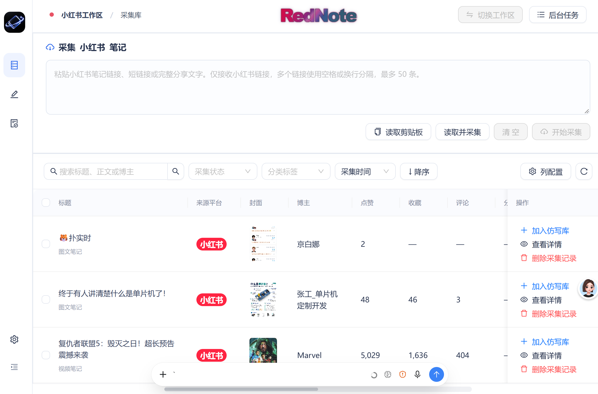
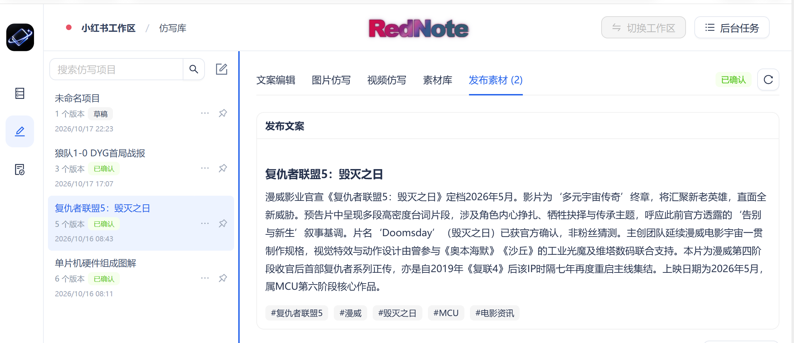
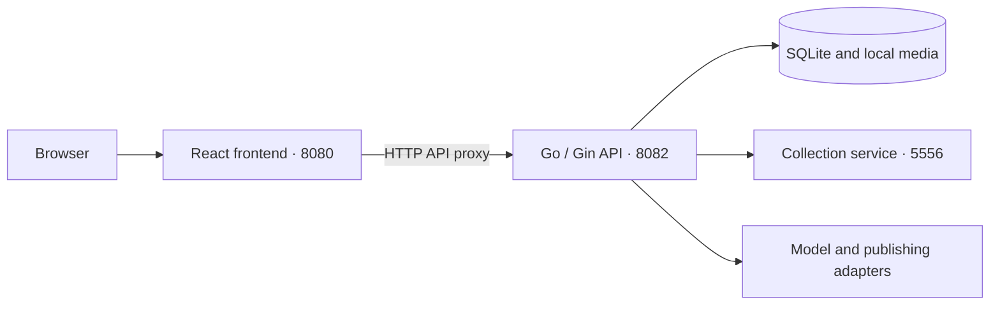

# RedNote_BuddY · Xiaohongshu Content Workspace

[简体中文](README.md) | English

A local workspace for collecting Xiaohongshu (RedNote) notes, drafting content, generating images and videos, managing media, and preparing publications. The React frontend and Go API are built, started, and updated independently, and communicate over HTTP. Existing workflows and local data are preserved in this architecture.

Repository: [caohch123/RedNote_BuddY](https://github.com/caohch123/RedNote_BuddY)

## Screenshots

### Collection Library

Collect Xiaohongshu notes, browse covers, authors, and engagement data, and add notes to the rewrite library.



### Rewrite Library and Publication Materials

Manage creative projects and text versions, preview confirmed copy, and organize images and videos for publication.



## Features

- **Collection library**: Collect notes from Xiaohongshu links or shared text, save media locally, extract text with OCR, and transcribe videos.
- **Rewrite library**: Start from a collected note or a blank project, keep text versions, and confirm the version to use.
- **Images and videos**: Select or upload reference media, analyze creative directions, review prompts, and generate content with your configured models.
- **Media management**: Organize images and videos by project, select publication materials, and adjust their order.
- **Publication management**: Validate copy and media, create publication draft snapshots, export drafts, and publish after signing in with your own QR code.
- **Background tasks**: Run tasks in the background, inspect their status, retry failures, and clear task history.

## Architecture



## Project Structure

```text
RedNote_BuddY/
├── frontend/         React + TypeScript + Vite; independent frontend service
│   ├── src/          Pages, components, state, and API client
│   ├── tests/        UI and frontend server tests
│   ├── server.mjs    Production static server and API reverse proxy
│   └── .env.example  API URL and development proxy configuration
├── backend/          Go + Gin; independent API and task service
│   ├── cmd/workbench/
│   ├── internal/     Business logic, storage, and service adapters
│   └── go.mod
├── engine/           Collection adapter and its own Python environment
├── publisher/        Publishing adapter and its own Python/Node environment
├── style-library/    Reference image library read by the backend
├── data/             Local database, account settings, media, and task records
├── bin/              Backend executables
├── scripts/          Setup, independent builds, startup, and shutdown
└── docs/             Feature, API, and architecture documentation
```

Runtime resources remain in their existing locations; the database is neither moved nor copied. The backend uses `--root` to locate the project root. The frontend does not read the database, account sessions, or model API keys directly.

## Quick Start

Requirements: Windows x64, Go 1.26+, Node.js 22+, and Python 3.12+. Media processing also requires FFmpeg / FFprobe. Existing installations can be reused.

```powershell
# Clone the repository
git clone https://github.com/caohch123/RedNote_BuddY.git
cd RedNote_BuddY

# Install dependencies and build for the first time
.\scripts\setup.ps1

# Start the frontend, backend, and collection service
.\scripts\start.ps1
```

Initial setup requires an internet connection to download dependencies. To select a Python installation, use `setup.ps1 -PythonPath 'C:\Python312\python.exe'`. Add FFmpeg / FFprobe to your system PATH or specify their paths in the workspace settings.

Once the page opens, enter your model endpoint, model name, and API key in Settings. See [config.example.json](config.example.json) for a sample configuration without real credentials.

Default addresses:

| Service | Address | Purpose |
| --- | --- | --- |
| Frontend | http://127.0.0.1:8080 | Web UI and `/api` proxy |
| Backend | http://127.0.0.1:8082/api/v1 | Business API, data, and tasks |
| Collection service | http://127.0.0.1:5556 | Xiaohongshu content collection |

The frontend and backend run as separate processes. The backend does not serve HTML or frontend build files. The production frontend service only needs Node.js and `frontend/dist`; React/Vite development dependencies are not required at runtime.

### Build and Run Services Independently

```powershell
.\scripts\build-frontend.ps1
.\scripts\build-backend.ps1

.\scripts\start-backend.ps1
.\scripts\start-frontend.ps1
```

Stop a running backend before replacing its executable. `start-backend.ps1` does not start the collection service. For the full workflow, use `start.ps1` or keep an existing collection service running.

Custom ports and data directory:

```powershell
.\scripts\start.ps1 -Address 127.0.0.1:8090 -ApiAddress 127.0.0.1:8092 -DataDir data -NoBrowser
.\scripts\doctor.ps1
.\scripts\stop.ps1
```

Use `stop.ps1 -Service frontend` or `stop.ps1 -Service backend` to stop one service without stopping the other service or the collector.

Before rebuilding after a source update, stop the affected service, then build and restart it. Existing users should retain the complete `data/` directory: a restorable backup includes both the database and media files.

The scripts reuse recorded processes and check their executables, creation times, and project paths to avoid affecting other projects.

## Development

Backend terminal:

```powershell
cd backend
$env:CGO_ENABLED='0'
$env:GOARCH='amd64'
go run ./cmd/workbench --root .. --addr 127.0.0.1:8082
```

Frontend terminal:

```powershell
cd frontend
npm ci
npm run dev
```

The development UI runs at http://127.0.0.1:5173. Vite proxies `/api` to port 8082. Backend changes do not require a frontend build, and frontend changes do not require a backend restart.

To access the API directly, copy `frontend/.env.example` to `frontend/.env.local` and set `VITE_API_BASE_URL=http://127.0.0.1:8082/api/v1`. `API_PROXY_TARGET` controls the development proxy target. Frontend environment variables are exposed in the build and must not contain secrets. Cross-origin requests use an explicit backend origin allowlist and remain subject to CSRF validation.

## Testing

```powershell
cd backend
go test -count=1 ./...

cd ../frontend
npm test
npm run test:server
npm run test:e2e
```

By default, UI regression tests use an isolated development server and mocked APIs. Tests against real model services are a separate, explicitly enabled workflow. The frontend/backend separation was validated with 470 backend tests and subtests, 30 frontend unit tests, and 16 UI regression tests. See the [architecture validation record](docs/frontend-backend.md#本次验证2026-10-17) for details (in Chinese).

## Local Data and Configuration

- The repository tracks source code, dependency lockfiles, sample configuration, and documentation, including demo screenshots.
- `data/`, `bin/`, virtual environments, `node_modules/`, frontend build files, test outputs, `.env.local`, and local assistant memory are excluded from commits.
- Model API keys, collection cookies, and creator-platform sessions are managed by the backend. Sensitive configuration is protected with DPAPI on Windows. Frontend environment variables are visible to the browser and must not contain API keys.
- `data/` is not included in the installation package or Git backups. Back it up separately before updates or migration.

## Suggested Extensions

Suggested order: reliability and data protection, followed by creative efficiency, then deployment options. These are proposed directions; scope and scheduling can follow actual needs.

| Stage | Area | Suggested work |
| --- | --- | --- |
| Near term | Publishing diagnostics and status verification | Capture error codes and sanitized logs for validation, upload, submission, and result confirmation. Provide diagnostic exports and distinguish upload failures from publication outcomes that still require verification. |
| Near term | Task recovery and cost controls | Strengthen concurrency limits, resumability, and duplicate-submission checks in the existing task system. Add generation budget limits and verify uncertain paid or publishing outcomes before deciding whether to retry. |
| Near term | Backup, recovery, and upgrades | Combine consistent SQLite snapshots with media manifests and file checksums. Add one-click backups, restore validation, and pre-upgrade rollback points. Require fresh sign-in and key configuration when moving to another machine. |
| Medium term | Creative templates and model adapters | Reuse text, image, and video prompt and parameter templates. Maintain model capability descriptions, parameter validation, and adapter tests; display usage estimates and limits before generation. |
| Medium term | Media deduplication and search | Identify duplicate media by content hash. Add tags, full-text search, and reference tracking, and show affected projects before cleanup to reduce duplicate storage and accidental deletion. |
| Medium term | API contracts and continuous integration | Describe interfaces with OpenAPI, generate TypeScript types or clients, and automatically run frontend/backend tests, API compatibility checks, and independent builds on pushes and pull requests. |
| Long term, as needed | Cross-platform and team deployment | Address Windows-specific paths, credential protection, and local dependencies before supporting other systems. A team edition would also need authentication, roles, workspace isolation, and auditing; evaluate database and object storage options against actual concurrency needs. |

Implementation references: [SQLite online backups](https://www.sqlite.org/backup.html), [OpenAPI Specification](https://spec.openapis.org/oas/latest.html), and [GitHub Actions](https://docs.github.com/en/actions/get-started/understand-github-actions).

## Further Documentation

Some of the linked documents are in Chinese:

- [Frontend/backend separation and deployment](docs/frontend-backend.md)
- [API reference](docs/api.md)
- [Local dependencies](docs/local-dependencies.md)
- [Image rewrite workflow](docs/image-workflow-v2.md)
- [Media library and publication boundaries](docs/media-library-actions-20261012.md)
- [Blank projects](docs/rewrite-blank-project-20261017.md)
- [Third-party publishing adapter](publisher/README.md)
- [Backend service adapters](backend/internal/providers/README.md)
- [Third-party sources and notices](publisher/NOTICE.md)

The publishing adapter uses unofficial Creator web interfaces. These interfaces and their signatures may change, and a successful publication does not imply platform approval of this automation method. The frontend/backend separation did not change the publishing mechanism.

The services are designed for a personal workspace on the local machine and listen on loopback addresses. Separating the frontend and backend does not add remote sign-in, multi-user permissions, or authentication for public internet deployment.
