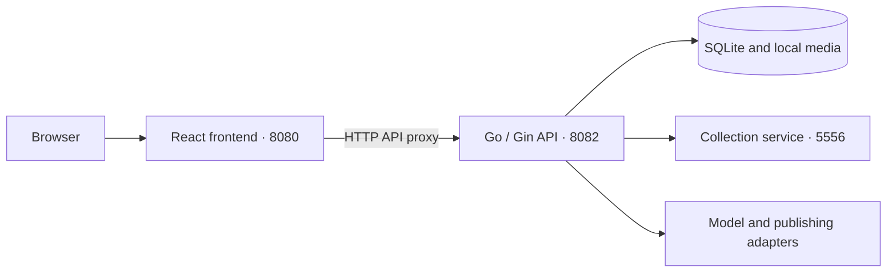

# RedNote_BuddY · Xiaohongshu Content Workspace

[简体中文](README.md) | English

A local workspace for collecting Xiaohongshu (RedNote) notes, creating content, and preparing publications, with separate user and administrator portals. The React frontend and Go API are built, started, and updated independently, and communicate over HTTP.

Repository: [caohch123/RedNote_BuddY](https://github.com/caohch123/RedNote_BuddY)

## Screenshots

These screenshots show the current application with demo accounts, sample media, and simulated usage data.

### Collection Library

Browse notes in a masonry feed of phone mockups. Read copy, page through images, and play videos directly inside each preview; selection, rewrite, and additional actions sit outside the device.


### Rewrite Library and Copy Editor

Edit the title, body, and topics in one content card, with save and confirm actions. A composer stays at the bottom for instructions, audience, tone, length, model, and version selection.


<details>
<summary>View billing and administration</summary>

### Billing Panel

Inspect input and output Tokens, usage trends, model distribution, and request details. Usage and costs in the screenshot are illustrative; real estimates use administrator-configured rates.


### Administrator Portal

Manage accounts, model services, request limits, tasks, and audit records from a separate portal.


</details>

## Features

- **Collection library**: Collect notes from Xiaohongshu links or shared text, save media locally, extract text with OCR, and transcribe videos. Switch between a masonry feed of phone previews and a table.
- **In-place reading**: Page through images with arrows, dots, a keyboard, or swipe gestures, and explicitly start video playback. Media loads as previews enter view, and videos pause when leaving the current preview.
- **Rewrite library**: Start from a collected note or a blank project, edit in one copy card, keep versions, and confirm the version to use. Generate a new version from the bottom composer with `Ctrl / ⌘ + Enter`.
- **Images and videos**: Select or upload reference media, analyze creative directions, review prompts, and generate content with your configured models.
- **Media management**: Organize images and videos by project, select publication materials, and adjust their order.
- **Publication management**: Validate copy and media, create publication draft snapshots, export drafts, and publish after signing in with your own QR code.
- **Background tasks**: Run tasks in the background, inspect their status, retry failures, and clear task history.
- **User and administrator portals**: Separate login realms, isolated member data, centralized model configuration, request limits, and audit records. Two random-password accounts are created on first startup.
- **Billing panel**: Track provider-reported Token usage by time, model, and capability, including input/output and cached/reasoning details. Administrators maintain rates; users can inspect cost estimates and export CSV records. Earlier usage is not reconstructed.

See [accounts and administration](docs/accounts-and-admin.en.md) for initial credentials, permissions, data ownership, and backups. Open `/` for the user workspace and `/admin` for administration. Temporary passwords for `user` and `admin` are stored locally in `data/initial-accounts.txt`; both must be changed on first login.

## Interface and Interaction

The user workspace, administrator portal, and login screens share warm backgrounds, charcoal text, and restrained terracotta accents. Clear type hierarchy and spacing separate content from actions. Phone previews preserve the appearance of collected content, and narrow layouts keep the main actions accessible.

Theme colors and component configuration live in `frontend/src/theme.ts`; page styling lives in `frontend/src/styles/editorial-theme.css`. After installing frontend dependencies, building, and starting the frontend, regenerate the four screenshots with:

```powershell
cd frontend
npm run docs:screenshots
```

The script defaults to `http://127.0.0.1:8080` and uses an isolated browser session with mocked APIs. It does not read local accounts, notes, or bills, and does not submit generation or publication tasks. Set `XHS_SCREENSHOT_URL` to use another running frontend, or `XHS_BROWSER_CHANNEL` to select an installed Playwright browser channel (default: `msedge`).

## Architecture



## Project Structure

```text
RedNote_BuddY/
├── frontend/         React + TypeScript + Vite; independent frontend service
│   ├── src/          Pages, components, state, and API client
│   ├── tests/        UI and frontend server tests
│   ├── server.mjs    Production static server and API reverse proxy
│   └── .env.example  API URL and development proxy configuration
├── backend/          Go + Gin; independent API and task service
│   ├── cmd/workbench/
│   ├── internal/     Business logic, storage, and service adapters
│   └── go.mod
├── engine/           Collection adapter and its own Python environment
├── publisher/        Publishing adapter and its own Python/Node environment
├── style-library/    Reference image library read by the backend
├── data/             Local database, account settings, media, and task records
├── bin/              Backend executables
├── scripts/          Setup, independent builds, startup, and shutdown
└── docs/             Feature, API, and architecture documentation
```

Runtime resources remain in their existing locations; the database is neither moved nor copied. The backend uses `--root` to locate the project root. The frontend does not read the database, account sessions, or model API keys directly.

## Quick Start

Requirements: Windows x64, Go 1.26+, Node.js 22+, and Python 3.12+. Media processing also requires FFmpeg / FFprobe. Existing installations can be reused.

```powershell
# Clone the repository
git clone https://github.com/caohch123/RedNote_BuddY.git
cd RedNote_BuddY

# Install dependencies and build for the first time
.\scripts\setup.ps1

# Start the frontend, backend, and collection service
.\scripts\start.ps1
```

Initial setup requires an internet connection to download dependencies. To select a Python installation, use `setup.ps1 -PythonPath 'C:\Python312\python.exe'`. Add FFmpeg / FFprobe to your system PATH or specify their paths on the administrator model settings page.

Read the random initial passwords from local `data/initial-accounts.txt`, sign in as `admin` at `/admin`, and change the temporary password. Configure shared model endpoints and keys in the administrator console. Sign in as `user` at `/` to use the creative workspace. See [config.example.json](config.example.json) for a sample configuration without real credentials.

Default addresses:

| Service | Address | Purpose |
| --- | --- | --- |
| Frontend | http://127.0.0.1:8080 | Web UI and `/api` proxy |
| Backend | http://127.0.0.1:8082/api/v1 | Business API, data, and tasks |
| Collection service | http://127.0.0.1:5556 | Xiaohongshu content collection |

The frontend and backend run as separate processes. The backend does not serve HTML or frontend build files. The production frontend service only needs Node.js and `frontend/dist`; React/Vite development dependencies are not required at runtime.

### Build and Run Services Independently

```powershell
.\scripts\build-frontend.ps1
.\scripts\build-backend.ps1

.\scripts\start-backend.ps1
.\scripts\start-frontend.ps1
```

Stop a running backend before replacing its executable. `start-backend.ps1` does not start the collection service. For the full workflow, use `start.ps1` or keep an existing collection service running.

Custom ports and data directory:

```powershell
.\scripts\start.ps1 -Address 127.0.0.1:8090 -ApiAddress 127.0.0.1:8092 -DataDir data -NoBrowser
.\scripts\doctor.ps1
.\scripts\stop.ps1
```

Use `stop.ps1 -Service frontend` or `stop.ps1 -Service backend` to stop one service without stopping the other service or the collector.

Before rebuilding after a source update, stop the affected service, then build and restart it. Existing users should retain the complete `data/` directory: a restorable backup includes both the database and media files.

The scripts reuse recorded processes and check their executables, creation times, and project paths to avoid affecting other projects.

## Development

Backend terminal:

```powershell
cd backend
$env:CGO_ENABLED='0'
$env:GOARCH='amd64'
go run ./cmd/workbench --root .. --addr 127.0.0.1:8082
```

Frontend terminal:

```powershell
cd frontend
npm ci
npm run dev
```

The development UI runs at http://127.0.0.1:5173. Vite proxies `/api` to port 8082. Backend changes do not require a frontend build, and frontend changes do not require a backend restart.

To access the API directly, copy `frontend/.env.example` to `frontend/.env.local` and set `VITE_API_BASE_URL=http://127.0.0.1:8082/api/v1`. `API_PROXY_TARGET` controls the development proxy target. Frontend environment variables are exposed in the build and must not contain secrets. Cross-origin requests use an explicit backend origin allowlist and remain subject to CSRF validation.

## Testing

```powershell
cd backend
go test -count=1 ./...

cd ../frontend
npm test
npm run test:server
npm run test:e2e
```

By default, UI regression tests use an isolated development server and mocked APIs. Tests against real model services are a separate, explicitly enabled workflow. The October 19, 2026 interface update passed the frontend build, 39 unit tests, the frontend server test, and 68 browser acceptance checks covering phone previews, image paging, video pausing, media menus, the bottom composer, billing, both portals, and responsive layouts. See the [architecture validation record](docs/frontend-backend.md#本次验证2026-10-17) for the earlier frontend/backend separation (in Chinese).

## Local Data and Configuration

- The repository tracks source code, dependency lockfiles, sample configuration, and documentation, including demo screenshots.
- `data/`, `bin/`, virtual environments, `node_modules/`, frontend build files, test outputs, `.env.local`, and local assistant memory are excluded from commits.
- Model API keys, collection cookies, and creator-platform sessions are managed by the backend. Sensitive configuration is protected with DPAPI on Windows. Frontend environment variables are visible to the browser and must not contain API keys.
- `data/` is not included in the installation package or Git backups. Back it up separately before updates or migration.

## Suggested Extensions

Suggested order: reliability and data protection, followed by creative efficiency, then deployment options. These are proposed directions; scope and scheduling can follow actual needs.

| Stage | Area | Suggested work |
| --- | --- | --- |
| Near term | Publishing diagnostics and status verification | Capture error codes and sanitized logs for validation, upload, submission, and result confirmation. Provide diagnostic exports and distinguish upload failures from publication outcomes that still require verification. |
| Near term | Task recovery and cost controls | Strengthen concurrency limits, resumability, and duplicate-submission checks in the existing task system. Add generation budget limits and verify uncertain paid or publishing outcomes before deciding whether to retry. |
| Near term | Backup, recovery, and upgrades | Combine consistent SQLite snapshots with media manifests and file checksums. Add one-click backups, restore validation, and pre-upgrade rollback points. Require fresh sign-in and key configuration when moving to another machine. |
| Medium term | Creative templates and model adapters | Reuse text, image, and video prompt and parameter templates. Maintain model capability descriptions, parameter validation, and adapter tests; display usage estimates and limits before generation. |
| Medium term | Media deduplication and search | Identify duplicate media by content hash. Add tags, full-text search, and reference tracking, and show affected projects before cleanup to reduce duplicate storage and accidental deletion. |
| Medium term | API contracts and continuous integration | Describe interfaces with OpenAPI, generate TypeScript types or clients, and automatically run frontend/backend tests, API compatibility checks, and independent builds on pushes and pull requests. |
| Long term, as needed | Cross-platform and team deployment | Address Windows-specific paths, credential protection, and local dependencies before supporting other systems. Build on existing authentication, roles, workspace isolation, and auditing with HTTPS, account recovery, and operational monitoring; evaluate database and object storage options against actual concurrency needs. |

Implementation references: [SQLite online backups](https://www.sqlite.org/backup.html), [OpenAPI Specification](https://spec.openapis.org/oas/latest.html), and [GitHub Actions](https://docs.github.com/en/actions/get-started/understand-github-actions).

## Further Documentation

Some of the linked documents are in Chinese:

- [Frontend/backend separation and deployment](docs/frontend-backend.md)
- [API reference](docs/api.md)
- [Billing panel and usage accounting](docs/billing.md)
- [Local dependencies](docs/local-dependencies.md)
- [Image rewrite workflow](docs/image-workflow-v2.md)
- [Media library and publication boundaries](docs/media-library-actions-20261012.md)
- [Blank projects](docs/rewrite-blank-project-20261017.md)
- [Third-party publishing adapter](publisher/README.md)
- [Backend service adapters](backend/internal/providers/README.md)
- [Third-party sources and notices](publisher/NOTICE.md)

The publishing adapter uses unofficial Creator web interfaces. These interfaces and their signatures may change, and a successful publication does not imply platform approval of this automation method. The frontend/backend separation did not change the publishing mechanism.

The current application includes user authentication, administrator permissions, data isolation, and audit records. Services listen on loopback addresses by default. Public internet deployment still requires separate HTTPS, reverse-proxy, access-control, and operational configuration; frontend/backend separation alone does not provide that deployment setup.
