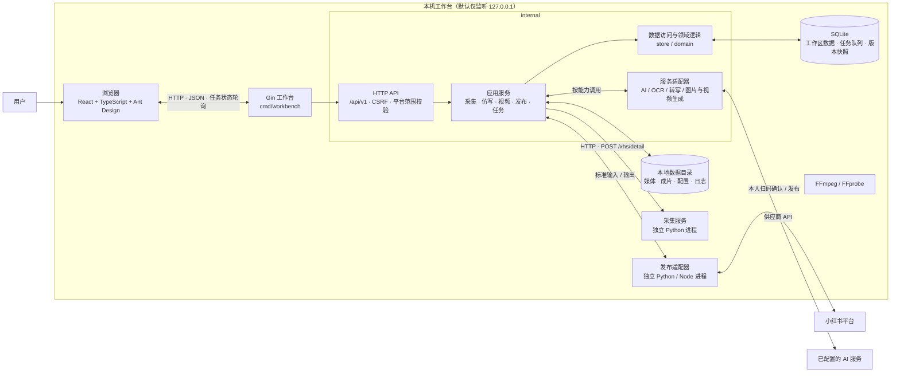
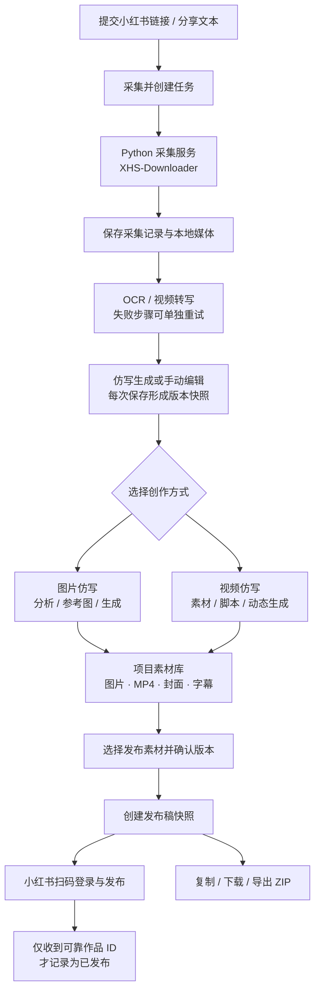

# 小红书内容工作台

> 项目交接前请先阅读：[项目进度与交接说明（2026-10-11）](docs/project-progress-20261011.md)

这是一个基于 Gin 的本机个人内容工作台，面向小红书。工作区包含采集库、仿写库、发布管理三大入口，形成一条完整链路：小红书链接采集 → 本地媒体落盘 → OCR / 视频转写 → 版本化文案仿写 → 图片仿写 / 动态视频生成 → 本人扫码登录发布 → 发布包导出。

## 文档导航

- [项目概览](#项目概览)
- [快速开始](#快速开始)
- [核心使用流程](#核心使用流程)
- [服务配置](#服务配置)
- [架构与数据](#架构与数据)
- [视频工作进程](#视频工作进程)
- [开发与验证](#开发与验证)
- [第三方来源](#第三方来源)

## 项目概览

### 1. 主要能力

- 采集：支持小红书 URL、批量链接、分享文本等内容入库，按作品 ID 去重。
- 仿写：对采集内容进行版本化处理，保留原文与输入快照，可继续生成发布稿和视频稿。
- 图片仿写：一张主图与最多两张辅助图；八项要求分别选择图片来源、自定义或交给模型，主体与动作独立。审阅提示词后生成 1–4 张图片，也支持不借用图片特征的自定义生成。见 [V2 工作流与接口](docs/image-workflow-v2.md)。
- 视频仿写：自动带入原视频，选择参考视频／图片及要求，审阅最终提示词后确认生成动态视频。
- 发布：支持扫码登录和上传确认，按账号、文案、素材顺序和可见性进行最终确认发布。
- 资源管理：素材库、项目记录、发布稿、任务状态均按工作区和项目隔离。

### 2. 工作区逻辑

- 工作台面向小红书，采集记录、仿写项目、视频项目、任务、发布稿、账号面板统一管理。
- 与小红书不匹配的历史数据保留在数据库，但会被隐藏，不能预览、导出或发布。

### 3. 素材与参考图

- 素材库位于每个仿写项目内部，与文案编辑、图片仿写、视频仿写并列。
- 生成结果默认只入素材库；采用或从库加入后才进入发布素材。素材库支持删除，已有历史与发布引用保留；版本对比仅位于文案编辑。见 [素材库与发布边界修复记录](docs/media-library-actions-20261012.md)。
- 展示当前项目已落地的图片仿写结果、视频生成配图、视频成片及用户上传图片，支持预览、搜索、来源与类型筛选及下载。
- 发布素材页签用于选择素材和调整发布顺序。
- 辅助图可从官方参考图库选择，支持领域分类和搜索；当前交付代码与上架逻辑不预填或生成图片。
- 参考图配置和本地文件放置方式见 [风格图库说明](style-library/README.md)。

### 4. 登录与发布说明

- 普通登录和账号刷新不启动浏览器；只有进入发布阶段或主动打开验证窗口时才会启用 Edge。
- 详细说明见：[扫码登录与发布](docs/xhs-publishing.md)。

## 快速开始

### 环境要求

- Windows x64
- Go >= 1.26
- Node.js >= 22
- Python >= 3.12
- FFmpeg / FFprobe
- 已安装的 Chrome 或 Edge

SQLite 使用纯 Go 驱动，不需要 GCC 或单独安装数据库。

### 一键启动

在项目目录打开 PowerShell：

```powershell
.\scripts\setup.ps1
.\scripts\start.ps1
```

默认访问地址：

- 工作台：`http://127.0.0.1:8080`
- 采集服务：`http://127.0.0.1:5556`

启动脚本会将辅助进程放到后台，并在准备好后自动打开浏览器。重复启动会复用本项目已记录的进程。

### 健康检查与停止

```powershell
.\scripts\doctor.ps1
.\scripts\stop.ps1
```

说明：

- `doctor.ps1` 仅检查本地依赖和进程状态，不暴露密钥。
- `stop.ps1` 仅终止记录中路径和创建时间均匹配的本项目进程。

### 常用启动参数

- `setup.ps1 -PythonPath 'C:\Python312\python.exe'`：指定 Python 路径
- `start.ps1 -NoBrowser`：仅启动服务，不打开浏览器
- `start.ps1 -SkipEngine`：使用已有采集服务
- `start.ps1 -Address '127.0.0.1:8081' -DataDir 'data-alternate'`：自定义端口和数据目录

说明：

- 首次安装需要访问 npm、Go 模块代理、PyPI 和 GitHub。
- 采集引擎准备脚本会固定 XHS-Downloader 2.8 的提交 `47840a1bee8438324ff10753c4291148c46071c8`，并校验下载校验和。
- 依赖会使用独立 `.venv` 和上游锁文件安装，避免污染全局环境。
- FFmpeg / FFprobe 可以安装到系统 PATH，也可以放到项目 `tools\ffmpeg\bin` 中。在设置的本地依赖列表统一编辑工具路径：支持完整路径、程序名、项目相对路径及留空自动检测。Node.js 配置用于小红书签名，检测与实际执行使用同一路径。详见[本地依赖说明](docs/local-dependencies.md)。
- 自定义 Chromium 可通过环境变量 `HYPERFRAMES_BROWSER_PATH` 指定。

## 核心使用流程

> 先完成采集，再进行仿写和发布。

### 1. 设置

管理小红书账号和采集环境：

- 可填写采集 Cookie 和采集服务地址。
- AI 服务的 API 地址、模型和密钥共用配置。
- 密钥由后端保存，Windows 下使用 DPAPI 保护；读取时仅返回掩码和状态。

### 2. 采集库

- 粘贴小红书的 URL、多链接或分享文字（单次最多 50 条）。
- 按作品 ID 去重。
- 可查看下载、OCR、转写的状态，并在详情中修正提取文字后重试失败步骤。

### 3. 仿写库

- 选择采集记录加入仿写。
- 配置目标读者、语气、长度以及补充要求。
- 文本生成自动读取来源笔记的完整标题、正文和所有可用 OCR / 转写（含人工修正），无需手动勾选。
- 每次生成或手动保存都会创建新版本，原文和本次输入快照会保留。
- 确认版本后，可创建小红书发布稿，视频稿从“视频仿写”页签进入。

### 4. 图片仿写 / 视频仿写

- 文案、图片、视频分别独立处理；未编辑时自动沿用已有内容。
- 小红书支持七项图片特征分析、自定义风格以及参考图生成。
- 图片仿写结果只更新发布素材，不覆盖文案编辑内容。
- 视频独立使用原视频、参考素材和补充要求；可从纯文字开始，不自动附加正文。
- 审阅可编辑的最终提示词后确认生成单条动态视频；原生声音、时长、比例和分辨率可选。
- 视频结果默认只进素材库，采用后才调整发布素材；旧配音合成流程已移除。
- 详细操作步骤见：[图片与视频仿写](docs/visual-rewrites.md)。

### 5. 发布管理

- 显示小红书的发布账号、稿件与创作平台入口。
- 扫码登录、核对账号、文案、素材顺序和公开状态后确认提交。
- 任务收到真实作品 ID 后才记为“已发布”。
- 也支持复制文案、素材下载、导出 ZIP、手动记录发布结果。导出与复制不会标记成功。

### 6. 数据管理与删除

- 删除采集记录、仿写项目、制作项目、发布稿均具备入口和二次确认。
- 删除来源时，会清除关联的仿写、制作、发布稿、任务和不再被用到的本地媒体。
- 仅影响本机，不会删除已发布的平台作品。
- 此操作没有回收站，请务必先备份需要保留的数据。

## 服务配置

`config.example.json` 展示设置接口结构，实际密钥应通过设置页面保存，不要直接提交到源码。各能力独立配置，完整协议说明见：[服务适配器说明](internal/providers/README.md)、[API 文档](docs/api.md)。

| 能力 | 默认协议与模型 |
| --- | --- |
| 文案仿写 / 脚本编排 | 百炼兼容 Chat Completions，`qwen-plus`；可替换支持 JSON 的文本接口 |
| 图片特征分析 | 多模态 Chat Completions，`qwen3-vl-plus` |
| 图片 OCR | 百炼视觉文字接口，`qwen3.5-ocr` |
| 视频转写 | 百炼 WebSocket，`paraformer-realtime-v2`；上传 FFmpeg 提取的 PCM |
| 视频仿写 | 阿里云百炼万相3.0，原生异步API，支持参考素材和模型原生声音 |
| 图片生成 | 用户配置兼容 `/images/generations` 的 API 地址、模型和密钥，初始为待配置 |

说明：

- 模型标识需以供应商对当前账号开放的模型为准。
- 图片生成连接检测只会查询 `/models`，不会创建图片，也不保证供应商的实际调用权限。
- 图片生成请求结果不明时会暂停，需要核查供应商记录；不会在重启后自动重复提交。
- 采集调用 XHS-Downloader 的 `POST /xhs/detail`，固定使用 `download=false` 和 `check_record=false`。
- Gin 会自行去重并保存媒体，上游返回的敏感参数不会原样返回前端。

## 架构与数据

### 运行时组件与通信



### 主要数据流



采集任务、仿写版本、视频项目和发布稿都关联所属工作区；发布稿保存确认版本与所选素材的快照。任务队列和业务记录持久化在 SQLite，本地媒体与渲染产物保存在数据目录中。

### 代码目录

```text
xhs-workbench/
├── cmd/
│   └── workbench/
│       └── main.go                 程序入口：加载配置并启动 Gin
├── internal/
│   ├── app/                        应用用例、业务流程与后台任务
│   │   ├── app.go                  应用依赖与服务初始化
│   │   ├── production.go           生产环境组装
│   │   ├── workers.go              持久化任务的执行与恢复
│   │   ├── workspace*.go           工作区注册、平台隔离与生命周期
│   │   ├── collections.go          采集记录与状态管理
│   │   ├── rewrites.go             仿写项目与版本管理
│   │   ├── visual_rewrites.go      图片仿写与视觉生成流程
│   │   ├── video_rewrite_v2.go     动态视频仿写工作流
│   │   ├── videos.go               视频项目与渲染任务
│   │   ├── publications.go         发布稿、导出与发布状态
│   │   ├── xhs_*.go                小红书账号与发布流程
│   │   ├── media*.go               媒体库、选择、上传与删除
│   │   ├── settings.go             设置、密钥保护及配置读取
│   │   └── *_test.go               应用逻辑与集成测试
│   ├── domain/                     领域类型与共享规则
│   │   ├── domain.go
│   │   ├── note_titles.go
│   │   └── visual.go
│   ├── providers/                  外部服务与子进程适配器
│   │   ├── client.go               通用 HTTP / 模型客户端
│   │   ├── collector.go            采集服务客户端
│   │   ├── audio.go                转写与语音能力
│   │   ├── image.go                图片生成能力
│   │   ├── visual.go               视觉分析能力
│   │   ├── xhs_publisher*.go       小红书发布进程适配
│   └── store/                      SQLite 持久化、事务与迁移
│       ├── store.go
│       ├── transaction.go
│       └── migrations/
│           └── 001_initial.sql
├── web/                            React + TypeScript + Vite + Ant Design
│   ├── src/
│   │   ├── main.tsx, App.tsx       前端入口与应用外壳
│   │   ├── api.ts, types.ts        API 客户端与共享类型
│   │   ├── platform.ts             平台上下文与平台切换
│   │   ├── workspace*.tsx          工作区状态与注册
│   │   ├── pages/                  采集、仿写、发布、设置页面
│   │   ├── components/             账号面板、媒体库、图片/视频工作区等
│   │   ├── hooks.ts, utils.ts      前端 hooks 与通用工具
│   │   └── style.css               全局样式
│   ├── public/                     静态资源
│   ├── tests/                      浏览器端到端测试
│   ├── qa/                         界面验收辅助资源
│   └── scripts/                    前端测试与开发辅助脚本
├── engine/                         XHS-Downloader 采集服务
│   ├── server.py                   Python HTTP 服务入口
│   ├── prepare.py                  固定版本准备与依赖安装
│   ├── upstream.lock.json          上游版本与校验信息
│   └── vendor/                     固定提交的上游源码
├── publisher/                      小红书扫码登录与发布适配器
│   ├── bridge.py                   Python stdio 桥接入口
│   ├── signer.cjs                  Node 签名辅助程序
│   ├── prepare.py                  发布组件准备脚本
│   ├── upstream.lock.json          上游版本与校验信息
│   └── tests/                      桥接测试
├── scripts/                        Windows 环境与进程管理
│   ├── setup.ps1                   安装与准备依赖
│   ├── start.ps1                   启动工作台及辅助服务
│   ├── stop.ps1                    停止本项目启动的进程
│   ├── doctor.ps1                  环境与进程检查
│   └── common.ps1                  脚本共享逻辑
├── docs/                           API、发布、登录、验收与交接说明
├── style-library/                  风格参考图库配置与使用说明
├── data/                           本机运行数据，不是源代码
│   ├── SQLite 数据库与受保护配置
│   ├── 采集媒体、项目素材与视频成片
│   └── 任务状态、渲染版本与日志
├── config.example.json              配置结构示例（不含真实密钥）
├── go.mod                           Go 模块与依赖声明
└── README.md                        项目说明、启动方式与架构文档
```

上图列出核心源码与职责，未展开测试文件和运行时依赖目录（例如 `node_modules`、`.venv`）；数据目录中的实际文件由运行时生成。

### 关键约定

- 持久化任务队列保存在 SQLite 中，服务重启后可恢复待执行任务。
- 采集、视频生成、渲染分别单并发，OCR 为双并发。
- 失败步骤可独立重试；采集更新不会覆盖已有的仿写和制作版本。
- API 基路径为 `/api/v1`，资源分组包括：
  - `/workspaces`
  - `/collections`
  - `/rewrites`
  - `/video-projects`
  - `/publications`
  - `/jobs`
  - `/settings`
  - `/assets`
- 请求中带 `platform=xiaohongshu`，后端会据此限制资源的读取和修改。
- `GET /session` 返回 CSRF token；写操作需要同源和 `X-CSRF-Token`。
- 耗时操作返回 `202 {job_id}`，前端每两秒轮询状态。
- 资源接口返回 JSON，列表返回 `{items,total}`，错误返回 `{error,code}`。

### 数据安全与备份

- 服务默认仅监听回环地址。
- 上传素材按资源 ID 提供访问，并限制在数据目录内。
- 采集下载会校验来源域名、重定向和目标 IP。
- 发布稿是已确认版本和选定素材的快照；旧成片会保留，但当前稿会提示内容不一致。
- 备份时请先停止服务，再完整复制实际数据目录；数据库和媒体必须一起备份。
- DPAPI 密文与 Windows 用户绑定，迁移到其他用户后需重新填写密钥。

## 视频生成

视频使用百炼 `wan3.0-video`／`wan3.0-video-prime` 原生异步接口和独立的三阶段工作台，详见 [视频仿写V2](docs/video-rewrite-v2.md)。参考视频由确认后的任务自动上传至百炼私有临时空间，无需手填公网链接或配置云存储。最终提示词可直接编辑，按确认内容原样提交。单条1–15秒、最多100MB，合计最多15秒，输入与输出时长合计最多30秒；纯文字／图片输出2–30秒。原供应商密钥不会自动带入百炼，请在设置中配置同地域的原生API地址、模型和密钥。生成脚本不会生视频；只有用户确认后才提交一次视频生成任务。结果先进入素材库，未知提交不自动重投。

## 开发与验证

### Go 与前端构建

```powershell
$env:CGO_ENABLED='0'; $env:GOARCH='amd64'
go test ./...
go build -o .\bin\xhs-workbench.exe ./cmd/workbench
```

在 `web` 中执行：

```powershell
npm run build
npm run dev
```

前端测试：

- 单元测试：`npm test`
- 浏览器测试：`npm run test:e2e`（固定使用本机 Microsoft Edge 和 Vite 预览）

### Python 服务单独运行

```powershell
engine\.venv\Scripts\python.exe engine\server.py --data-dir data\engine --port 5556
```

### 视频模拟回归

```powershell
go test ./internal/app -run 'TestVideoV2|TestRetiredVideo' -count=1
```

模拟服务验证初始化、脚本、请求一致性、重复提交及恢复；真实生成须在用户审阅具体脚本后单独验收。旧配音、分镜和渲染任务已停用，已有文件及发布稿保留。

### 验收重点

- 重复采集与重试
- 局部失败与恢复
- 仿写版本绑定
- 远程视频任务恢复
- 脚本及素材链接一致性
- 原生声音与输出参数
- 旧任务停用及引用保护
- 发布 ZIP 与确认版本一致
- 导出后状态必须不变为“已发布”

## 第三方来源

- [XHS-Downloader 2.8](https://github.com/JoeanAmier/XHS-Downloader/tree/47840a1bee8438324ff10753c4291148c46071c8) — GPL-3.0；采集服务保留原源码、许可证和固定提交说明。
- [FFmpeg](https://ffmpeg.org/) — 采用本机已安装版本；其构建和许可证以对应分发包为准。

当前阶段面向本机单用户，不包含团队权限、评论采集、数字人、视频延长、局部重绘、定时发布、商品挂载或批量自动发布。
