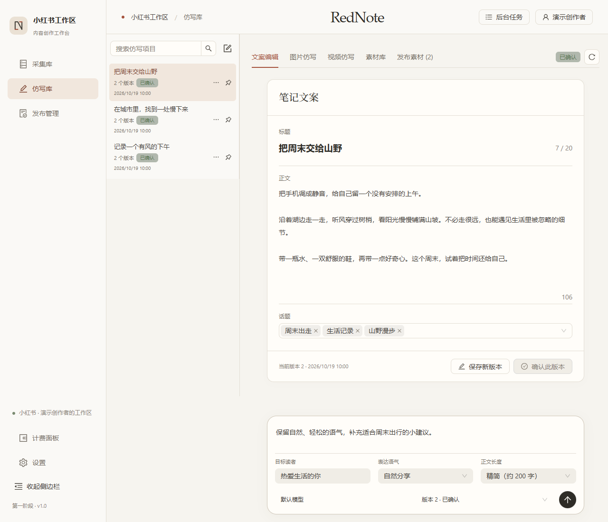
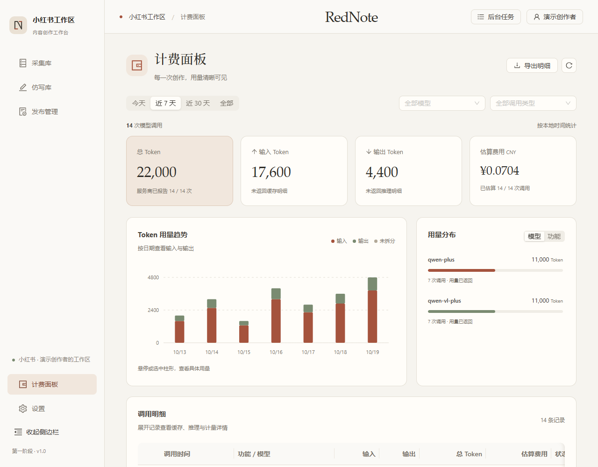
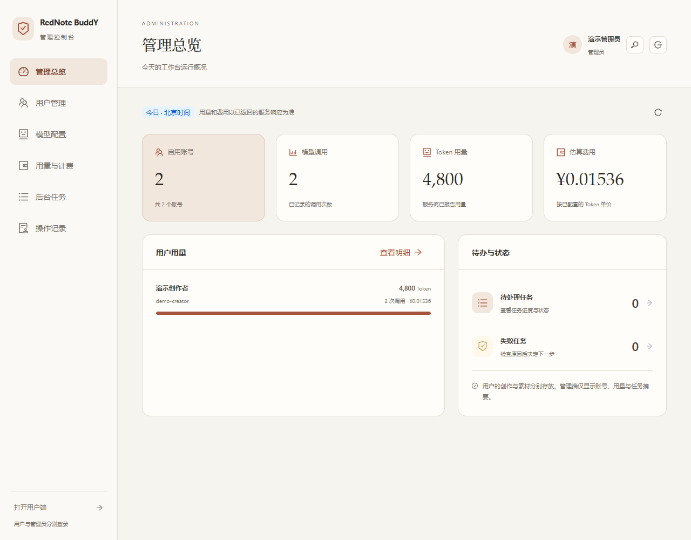
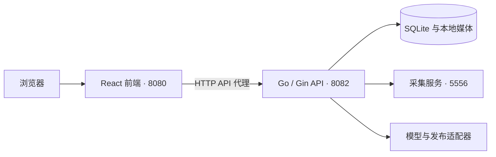

# RedNote_BuddY · 小红书内容工作台

简体中文 | [English](README.en.md)

面向小红书采集、创作与发布准备的本地工作台，提供独立用户端与管理员端。React 前端与 Go API 各自构建、启动和更新，通过 HTTP API 通信。

仓库：[caohch123/RedNote_BuddY](https://github.com/caohch123/RedNote_BuddY)

## 界面演示

以下截图为当前版本的实际界面，使用演示账号、示例素材与模拟用量。

### 采集库

以瀑布流展示手机外壳内的笔记预览，直接阅读正文、切换图片或播放视频；选择、加入仿写库及更多操作保留在卡片外。


### 仿写库与文案编辑

上方内容框整合标题、正文、话题与保存确认操作；底部固定文案对话框，集中调整读者、语气、长度、模型和版本。



<details>
<summary>查看计费面板与管理员端</summary>

### 计费面板

区分输入与输出 Token，展示趋势、模型分布和调用明细。截图中的用量与费用仅为演示；实际费用按管理员配置的单价估算。



### 管理员端

独立管理账号、模型服务、调用额度、任务与操作记录。



</details>

## 功能

- **采集库**：小红书链接与分享文本采集、本地素材保存、OCR 与视频转写；支持手机预览瀑布流和表格切换。
- **原地阅读**：预览内通过箭头、圆点、键盘或滑动切换图片，点击播放视频；素材按可见范围加载，离开当前预览后暂停视频。
- **仿写库**：从来源笔记或空白项目开始创作，在统一文案框中编辑，保留版本并确认采用；底部对话框支持 `Ctrl / ⌘ + Enter` 生成新版本。
- **图片与视频**：选择或上传参考素材，分析方向、审阅提示词，再调用已配置的模型生成。
- **素材管理**：按项目组织图片和视频，选择发布素材并调整顺序。
- **发布管理**：文案与媒体校验、发布稿快照、导出，以及本人扫码后的发布操作。
- **任务管理**：后台执行、状态查询、失败重试和历史清理。
- **双端与账号**：独立用户端与管理员端，支持账号管理、数据隔离、共享模型配置、调用额度与审计；首次启动生成两个随机密码账号。
- **计费面板**：记录服务商返回的 Token 用量，按时间、模型与功能可视化，查看输入/输出及缓存/推理明细；管理员维护单价，用户可查看费用估算并导出 CSV。

双端入口、数据归属、权限与备份方式见 [账号和管理端说明](docs/accounts-and-admin.md)。

## 界面与交互

用户端、管理员端和登录页采用统一的暖白背景、炭黑文字与陶土色强调。标题、内容与操作区域保持清晰层次，手机预览内部保留笔记内容的原始样貌，窄屏布局保留主要操作。

主题色与组件配置集中在 `frontend/src/theme.ts`，页面样式位于 `frontend/src/styles/editorial-theme.css`。安装前端依赖并构建、启动前端后，可重新生成本页四张截图：

```powershell
cd frontend
npm run docs:screenshots
```

截图脚本默认访问 `http://127.0.0.1:8080`，使用独立浏览器会话和模拟接口，不读取本地账号、笔记或账单，也不提交生成或发布任务。可用 `XHS_SCREENSHOT_URL` 指定已启动的前端地址，`XHS_BROWSER_CHANNEL` 指定已安装的 Playwright 浏览器通道（默认 `msedge`）。

## 架构



## 目录

```text
xhs-workbench/
├── frontend/         React + TypeScript + Vite；独立前端服务
│   ├── src/          页面、组件、状态与 API 客户端
│   ├── tests/        界面与前端服务测试
│   ├── server.mjs    生产静态服务及 API 反向代理
│   └── .env.example  API 地址与开发代理配置
├── backend/          Go + Gin；独立 API 与任务服务
│   ├── cmd/workbench/
│   ├── internal/     业务、存储、服务适配器
│   └── go.mod
├── engine/           后端采集适配器及其独立 Python 环境
├── publisher/        后端发布适配器及其独立 Python/Node 环境
├── style-library/    后端读取的参考图库
├── data/             原有数据库、账号配置、素材和任务记录
├── bin/              后端可执行文件
├── scripts/          安装、独立构建、独立启动与停止
└── docs/             功能、API 和架构文档
```

运行资源留在原路径，数据库没有迁移或复制。后端通过 `--root` 指定项目根目录，前端不读取数据库、账号会话或模型密钥。

## 快速开始

环境：Windows x64、Go 1.26+、Node.js 22+、Python 3.12+，媒体处理需要 FFmpeg / FFprobe。已有环境无需重新安装。

```powershell
# 获取源码
git clone https://github.com/caohch123/RedNote_BuddY.git
cd RedNote_BuddY

# 首次安装和构建
.\scripts\setup.ps1

# 启动前端、后端和采集服务
.\scripts\start.ps1
```

首次准备环境需要联网下载依赖。可用 `setup.ps1 -PythonPath 'C:\Python312\python.exe'` 指定 Python。FFmpeg / FFprobe 可安装到系统 PATH，或在管理员端的模型服务页指定路径。

首次启动后，从本机 `data/initial-accounts.txt` 获取 `user` 与 `admin` 的随机初始密码，登录后先修改密码。用户端为 `/`，管理员端为 `/admin`；模型地址、模型名称和密钥在管理员端配置。示例配置见 [config.example.json](config.example.json)，示例不含真实凭据。

默认地址：

| 服务 | 地址 | 职责 |
| --- | --- | --- |
| 前端 | http://127.0.0.1:8080 | 页面与 /api 代理 |
| 后端 | http://127.0.0.1:8082/api/v1 | 业务 API、数据与任务 |
| 采集服务 | http://127.0.0.1:5556 | 小红书内容采集 |

前端和后端是两个独立进程。后端不再提供 HTML 或前端构建产物。前端生产服务仅需 Node.js 和 `frontend/dist`，运行时不需要安装 React/Vite 开发依赖。

### 独立构建与启动

```powershell
.\scripts\build-frontend.ps1
.\scripts\build-backend.ps1

.\scripts\start-backend.ps1
.\scripts\start-frontend.ps1
```

已有后端运行时，替换可执行文件前应停止对应进程。`start-backend.ps1` 不启动采集服务；需要完整功能时使用一键启动，或保留现有采集服务。

自定义端口和数据目录：

```powershell
.\scripts\start.ps1 -Address 127.0.0.1:8090 -ApiAddress 127.0.0.1:8092 -DataDir data -NoBrowser
.\scripts\doctor.ps1
.\scripts\stop.ps1
```

单独停止前端或后端可使用 `stop.ps1 -Service frontend` / `stop.ps1 -Service backend`，不会停止另一端或采集服务。

更新源码和重建时，先停止对应服务，再构建与启动。已有用户请保留完整 `data/` 目录；数据库和媒体共同组成可恢复的数据备份。

脚本复用已记录的进程，并核对可执行文件、创建时间和项目路径，避免操作其他项目。

## 开发

后端终端：

```powershell
cd backend
$env:CGO_ENABLED='0'
$env:GOARCH='amd64'
go run ./cmd/workbench --root .. --addr 127.0.0.1:8082
```

前端终端：

```powershell
cd frontend
npm ci
npm run dev
```

开发页面为 http://127.0.0.1:5173，Vite 把 `/api` 代理到 8082。修改后端无需构建前端；修改前端无需重启后端。

需要直接访问独立 API 时，将 `frontend/.env.example` 复制为 `.env.local`，配置 `VITE_API_BASE_URL=http://127.0.0.1:8082/api/v1`。开发代理目标为 `API_PROXY_TARGET`。环境变量在前端构建时公开，不能放密钥。跨端口请求通过后端明确的来源白名单，并继续校验 CSRF。

## 测试

```powershell
cd backend
go test -count=1 ./...

cd ../frontend
npm test
npm run test:server
npm run test:e2e
```

默认界面回归使用独立开发服务器与模拟接口。真实模型联调属于单独的显式测试流程，不应与普通回归混用。2026-10-19 界面更新已通过前端构建、39 项基础测试、前端服务测试和 68 项浏览器验收，覆盖手机预览、翻页、视频暂停、素材菜单、底部文案对话框、计费、双端入口及多尺寸布局。此前架构拆分的验证记录见 [架构验证](docs/frontend-backend.md#本次验证2026-10-17)。

## 数据与本地配置

- 仓库只提交源码、依赖锁文件、示例配置和说明文档。
- `data/`、`bin/`、虚拟环境、`node_modules/`、前端构建产物、测试输出、`.env.local` 与本地助手记忆不提交。
- 模型密钥、采集 Cookie 和创作平台会话由后端管理；Windows 下使用 DPAPI 保护敏感配置。前端环境变量会公开到浏览器，不能填写密钥。
- `data/` 不属于安装包或 Git 备份；更新和迁移前应另行保存。

## 后续扩展建议

建议按“稳定性与数据安全 → 创作效率 → 部署扩展”的顺序推进。以下为后续建议，具体范围和排期可按实际需求确定。

| 阶段 | 方向 | 建议内容 |
| --- | --- | --- |
| 近期 | 发布诊断与状态核验 | 按校验、上传、提交和结果确认记录错误码及脱敏日志，提供诊断导出，准确区分上传失败与发布结果待核验。 |
| 近期 | 任务恢复与费用控制 | 在现有任务机制上增强并发限制、断点恢复和重复提交校验，增加生成预算上限；计费或发布结果不明时先核验再决定是否重试。 |
| 近期 | 备份、恢复与升级 | 为 SQLite 创建一致性快照，配合媒体清单与文件校验，增加一键备份、恢复验证及升级前回滚点；跨机器迁移时重新登录并配置密钥。 |
| 中期 | 创作模板与模型适配 | 复用文案、图片和视频的提示词及参数模板；为各模型维护能力说明、参数校验和适配器测试，生成前展示用量估算与限制。 |
| 中期 | 素材去重与检索 | 按文件内容哈希识别重复素材，增加标签、全文检索和引用关系，清理前展示受影响项目，减少重复保存与误删。 |
| 中期 | API 契约与持续集成 | 使用 OpenAPI 描述接口，生成 TypeScript 类型或客户端，并在提交与合并时自动运行前后端测试、接口兼容性检查和独立构建。 |
| 长期、按需 | 跨平台与团队部署 | 先梳理 Windows 路径、凭据保护及本机依赖，再提供其他系统的运行方案；现有登录、角色隔离与审计基础上补齐公网部署、HTTPS、身份恢复和运维监控，并按并发需求评估数据库和对象存储。 |

实施参考：[SQLite 在线备份](https://www.sqlite.org/backup.html)、[OpenAPI 规范](https://spec.openapis.org/oas/latest.html)、[GitHub Actions](https://docs.github.com/en/actions/get-started/understand-github-actions)。

## 文档

- [前后端分离与部署说明](docs/frontend-backend.md)
- [API 文档](docs/api.md)
- [计费面板与用量口径](docs/billing.md)
- [本地依赖](docs/local-dependencies.md)
- [图片仿写工作流](docs/image-workflow-v2.md)
- [素材库与发布边界](docs/media-library-actions-20261012.md)
- [空白项目](docs/rewrite-blank-project-20261017.md)
- [第三方发布适配器说明](publisher/README.md)
- [后端服务适配器](backend/internal/providers/README.md)
- [第三方来源与声明](publisher/NOTICE.md)

发布适配器使用非官方 Creator 网页接口，接口及签名可能变化，发布成功不代表平台认可该自动化方式。架构拆分没有修改发布机制。

当前版本已提供用户登录、管理员权限、数据隔离与操作审计，服务默认仅监听回环地址。公网部署仍需单独配置 HTTPS、反向代理、访问控制与运维监控；前后端分离本身不代表已完成公网部署。
