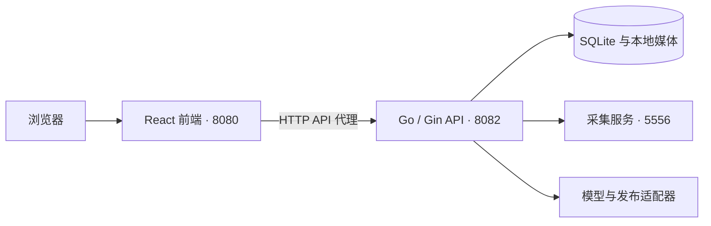

# RedNote_BuddY · 小红书内容工作台

项目采用前后端分离结构：React 前端与 Go API 各自构建、启动和更新，通过 HTTP API 通信。采集、仿写、图片和视频工作流、素材库、发布管理及原有数据均保留。

仓库：[caohch123/RedNote_BuddY](https://github.com/caohch123/RedNote_BuddY)

## 界面演示

### 采集库

采集小红书笔记，查看封面、作者及互动数据，并将内容加入仿写库。


### 仿写库与发布素材

管理创作项目与文案版本，在发布素材中预览确认后的文案并组织图片、视频。


## 功能

- **采集库**：小红书链接与分享文本采集、本地素材保存、OCR 与视频转写。
- **仿写库**：从来源笔记或空白项目开始创作，保留文案版本并确认采用。
- **图片与视频**：选择或上传参考素材，分析方向、审阅提示词，再调用已配置的模型生成。
- **素材管理**：按项目组织图片和视频，选择发布素材并调整顺序。
- **发布管理**：文案与媒体校验、发布稿快照、导出，以及本人扫码后的发布操作。
- **任务管理**：后台执行、状态查询、失败重试和历史清理。

## 架构



## 目录

```text
xhs-workbench/
├── frontend/         React + TypeScript + Vite；独立前端服务
│   ├── src/          页面、组件、状态与 API 客户端
│   ├── tests/        界面与前端服务测试
│   ├── server.mjs    生产静态服务及 API 反向代理
│   └── .env.example  API 地址与开发代理配置
├── backend/          Go + Gin；独立 API 与任务服务
│   ├── cmd/workbench/
│   ├── internal/     业务、存储、服务适配器
│   └── go.mod
├── engine/           后端采集适配器及其独立 Python 环境
├── publisher/        后端发布适配器及其独立 Python/Node 环境
├── style-library/    后端读取的参考图库
├── data/             原有数据库、账号配置、素材和任务记录
├── bin/              后端可执行文件
├── scripts/          安装、独立构建、独立启动与停止
└── docs/             功能、API 和架构文档
```

运行资源留在原路径，数据库没有迁移或复制。后端通过 `--root` 指定项目根目录，前端不读取数据库、账号会话或模型密钥。

## 快速开始

环境：Windows x64、Go 1.26+、Node.js 22+、Python 3.12+，媒体处理需要 FFmpeg / FFprobe。已有环境无需重新安装。

```powershell
# 获取源码
git clone https://github.com/caohch123/RedNote_BuddY.git
cd RedNote_BuddY

# 首次安装和构建
.\scripts\setup.ps1

# 启动前端、后端和采集服务
.\scripts\start.ps1
```

首次准备环境需要联网下载依赖。可用 `setup.ps1 -PythonPath 'C:\Python312\python.exe'` 指定 Python。FFmpeg / FFprobe 可安装到系统 PATH，或在工作台设置页指定路径。

页面打开后，在设置中填写自己的模型地址、模型名称和密钥。示例配置见 [config.example.json](config.example.json)，示例不含真实凭据。

默认地址：

| 服务 | 地址 | 职责 |
| --- | --- | --- |
| 前端 | http://127.0.0.1:8080 | 页面与 /api 代理 |
| 后端 | http://127.0.0.1:8082/api/v1 | 业务 API、数据与任务 |
| 采集服务 | http://127.0.0.1:5556 | 小红书内容采集 |

前端和后端是两个独立进程。后端不再提供 HTML 或前端构建产物。前端生产服务仅需 Node.js 和 `frontend/dist`，运行时不需要安装 React/Vite 开发依赖。

### 独立构建与启动

```powershell
.\scripts\build-frontend.ps1
.\scripts\build-backend.ps1

.\scripts\start-backend.ps1
.\scripts\start-frontend.ps1
```

已有后端运行时，替换可执行文件前应停止对应进程。`start-backend.ps1` 不启动采集服务；需要完整功能时使用一键启动，或保留现有采集服务。

自定义端口和数据目录：

```powershell
.\scripts\start.ps1 -Address 127.0.0.1:8090 -ApiAddress 127.0.0.1:8092 -DataDir data -NoBrowser
.\scripts\doctor.ps1
.\scripts\stop.ps1
```

单独停止前端或后端可使用 `stop.ps1 -Service frontend` / `stop.ps1 -Service backend`，不会停止另一端或采集服务。

更新源码和重建时，先停止对应服务，再构建与启动。已有用户请保留完整 `data/` 目录；数据库和媒体共同组成可恢复的数据备份。

脚本复用已记录的进程，并核对可执行文件、创建时间和项目路径，避免操作其他项目。

## 开发

后端终端：

```powershell
cd backend
$env:CGO_ENABLED='0'
$env:GOARCH='amd64'
go run ./cmd/workbench --root .. --addr 127.0.0.1:8082
```

前端终端：

```powershell
cd frontend
npm ci
npm run dev
```

开发页面为 http://127.0.0.1:5173，Vite 把 `/api` 代理到 8082。修改后端无需构建前端；修改前端无需重启后端。

需要直接访问独立 API 时，将 `frontend/.env.example` 复制为 `.env.local`，配置 `VITE_API_BASE_URL=http://127.0.0.1:8082/api/v1`。开发代理目标为 `API_PROXY_TARGET`。环境变量在前端构建时公开，不能放密钥。跨端口请求通过后端明确的来源白名单，并继续校验 CSRF。

## 测试

```powershell
cd backend
go test -count=1 ./...

cd ../frontend
npm test
npm run test:server
npm run test:e2e
```

默认界面回归使用独立开发服务器与模拟接口。真实模型联调属于单独的显式测试流程，不应与普通回归混用。最近一次架构拆分已通过 470 项后端测试及子用例、30 项前端基础测试和 16 项界面回归；详细记录见 [架构验证](docs/frontend-backend.md#本次验证2026-10-17)。

## 数据与本地配置

- 仓库只提交源码、依赖锁文件、示例配置和说明文档。
- `data/`、`bin/`、虚拟环境、`node_modules/`、前端构建产物、测试输出、`.env.local` 与本地助手记忆不提交。
- 模型密钥、采集 Cookie 和创作平台会话由后端管理；Windows 下使用 DPAPI 保护敏感配置。前端环境变量会公开到浏览器，不能填写密钥。
- `data/` 不属于安装包或 Git 备份；更新和迁移前应另行保存。

## 文档

- [前后端分离与部署说明](docs/frontend-backend.md)
- [API 文档](docs/api.md)
- [本地依赖](docs/local-dependencies.md)
- [图片仿写工作流](docs/image-workflow-v2.md)
- [素材库与发布边界](docs/media-library-actions-20261012.md)
- [空白项目](docs/rewrite-blank-project-20261017.md)
- [第三方发布适配器说明](publisher/README.md)
- [后端服务适配器](backend/internal/providers/README.md)
- [第三方来源与声明](publisher/NOTICE.md)

发布适配器使用非官方 Creator 网页接口，接口及签名可能变化，发布成功不代表平台认可该自动化方式。架构拆分没有修改发布机制。

当前服务仍定位为本机个人工作台，监听回环地址。前后端分离不等于已增加远程登录、多用户权限或公网部署认证。
