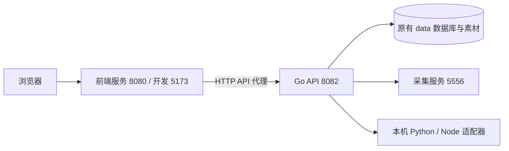

# 前后端分离

前端和后端使用独立目录、依赖、构建产物及进程。两者只通过 `/api/v1` 交互。



## 职责

`frontend` 包含 React 页面、样式、接口客户端和前端测试，构建产物为 `frontend/dist`。`server.mjs` 使用 Node 内置模块提供静态文件和流式 API 代理，不包含业务接口或数据库访问。可以替换成其他静态服务器和反向代理。

`backend` 是完整 Go module。数据库、工作区权限、素材、生成任务、账号凭据与发布逻辑归后端。Go 构建不需要前端目录和 Node 构建步骤，后端访问 `/` 返回 JSON 404。

`engine`、`publisher`、`style-library`、`tools` 和 `data` 保持原位置，由后端按项目根目录读取。这样不会移动 Windows 虚拟环境或改变用户保存的路径。单独分发后端时，按需携带这些后端运行资源；前端不依赖它们。

## 地址配置

| 配置 | 默认值 | 读取时机 |
| --- | --- | --- |
| 前端 `VITE_API_BASE_URL` | `/api/v1` | Vite 开发 / 构建 |
| 开发 `API_PROXY_TARGET` | `http://127.0.0.1:8082` | Vite 启动 |
| 生产 `API_PROXY_TARGET` / `--api-target` | `http://127.0.0.1:8082` | Node 前端启动 |
| 后端 `--addr` | `127.0.0.1:8082` | API 启动 |
| 后端 `--root` | `..`（从 backend 运行） | API 启动 |
| 后端 `--data-dir` | `data`，相对项目 root | API 启动 |
| 后端 `--allowed-origins` | 本机 8080 / 5173 的明确来源 | API 启动 |

推荐生产前端保持 `/api/v1`，通过反向代理通信；替换后端地址不需要重新构建页面。`VITE_API_BASE_URL` 为可选直接跨源连接方式，必须包含 `/api/v1`，上传、媒体、参考图库和下载均使用该配置。

前端变量会进入浏览器，不能配置 Cookie、账号会话、模型密钥或其他凭据。API 返回密钥掩码，Windows 账号会话继续由后端 DPAPI 加密。

## 独立运行

```powershell
# 后端：在项目根目录执行
.\scripts\start-backend.ps1

# 前端：可以另开终端；不会启动或重启后端
.\scripts\start-frontend.ps1
```

前端还可以直接从自身目录运行：

```powershell
cd frontend
npm run build
npm start -- --port 8080 --api-target http://127.0.0.1:8082
```

开发前端用 `npm run dev`。首次安装用 `npm ci`，只运行已有生产构建时不需要前端 node_modules。生产前端 `/healthz` 检查页面服务；后端 `/api/v1/health` 检查业务和运行依赖。

改变前端端口后，后端必须配置对应的精确 Origin：

```powershell
.\scripts\start-backend.ps1 -Address 127.0.0.1:8092 -AllowedOrigins 'http://127.0.0.1:8090,http://localhost:8090'
.\scripts\start-frontend.ps1 -Address 127.0.0.1:8090 -ApiAddress 127.0.0.1:8092
```

后端继续检查 Host、精确 Origin 和修改请求的 CSRF。预检请求无需 CSRF，实际修改请求必须带令牌。来源白名单不能使用 `*`；仅配置前端页面确实使用的来源。下载文件名、Range 媒体请求和上传流均由代理保留。

## 迁移对应

| 旧路径 / 行为 | 新路径 / 行为 |
| --- | --- |
| `web/` | `frontend/` |
| `cmd/`、`internal/`、`go.mod`、`go.sum` | `backend/` 内相同路径 |
| Go 8080 同时提供 HTML 与 API | 前端 8080，Go API 8082 |
| 后端读取 `web/dist` | 后端不读取前端文件 |
| `go test` 在根目录执行 | 在 `backend` 目录执行 |
| `data/workbench.db` 与媒体 | 原位保留，无需迁移 |

旧文档的测试命令若是 Go 相对路径，应从 `backend` 执行。历史测试记录描述当时的运行地址；当前目录和启动方式以本文和根 README 为准。不要让两个后端实例同时使用同一个数据目录。

此版本保留本机部署边界。对外部署前还需要单独设计身份认证、用户隔离和凭据存储，不能直接把现有本机 API 暴露到公网。

## 本次验证（2026-10-17）

- 后端完整回归：`go test -count=1 -vet=off -timeout=8m -json ./...`，470 项测试及子用例通过；不将该命令视为 vet 检查。
- 前端基础测试 30 项、界面回归 16 项全部通过；生产服务测试覆盖流式上传、Range、文件下载、静态资源与后端不可用。
- 临时数据库真实联调通过：独立前端 → 代理 → Go API → SQLite，完成空白创建、保存、确认、上传、图片预览与刷新恢复；浏览器直接跨源请求的预检与 CSRF 校验也通过。没有使用个人数据库生成测试内容，也没有调用付费生成或真实发布。
- Vite 开发服务 5173 到真实 API 8082 的代理验证通过，包括 Host 转换和 Origin 保留。
- 独立构建、重复启动复用与运行检查通过。8080 为 Node 前端，8082 为 Go API，原有 5556 采集进程保留。
- 切换前后逐项核对记录 ID：采集记录 3、仿写项目 3、发布稿 3、素材 11、任务 34，均保持一致。
- 记录位于 `data/verification/separation-*.json`、`separation-backend-20261017.jsonl` 与 `separation-ui-20261017.png`。


## 用户端与管理端

后端生产入口现在使用 Portal 会话层，所有业务 API 必须先登录，初始用户保留原有数据；新增用户分别使用独立数据目录。`/` 与 `/admin` 使用不同的 HttpOnly Cookie 和会话 CSRF，可同时登录。管理员统一维护模型和额度，普通用户设置页仅管理个人连接。首次账号与迁移备份方法见 [账号和管理端](accounts-and-admin.md)。内部 `App.Router()` 仅用于 Portal 分发及业务测试，不能绕过 Portal 作为生产监听器。
