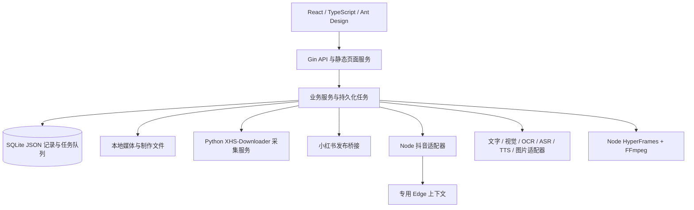

# 小红书内容工作台：项目进度与成员交接说明

> 更新日期：2026-10-11（Asia/Shanghai）  
> 适用对象：产品、设计、前端、后端、平台适配、AI 与测试成员  
> 当前定位：Windows 本机单用户应用，处于功能迭代与真实服务验收阶段。

> 同日后续更新：图片仿写已重构为 V2 三阶段流程。成员请优先阅读 [新版工作流与接口](image-workflow-v2.md) 和 [新版验证记录](image-workflow-v2-test-record-20261011.md)；本文后续的旧图片流程描述作为迭代背景保留。

> 2026-10-12 后续更新：新图片方案采用八项独立控制，每项可选主图、辅助图、自定义或交给模型，主体与动作拆分，移除固定案例模式。当前接口与行为以 [工作流说明](image-workflow-v2.md) 为准；实现、兼容和 64 项 Edge 验收见 [本轮记录](image-flexible-workflow-20261012.md)。本轮没有新增真实生图调用。

> 2026-10-12 素材管理更新：生成结果默认只入素材库，明确采用或从库加入后才进入发布选择；补充库内删除、有效选图搜索及文案内版本对比。见 [实现与验收记录](media-library-actions-20261012.md)。

本文依据当前源码、README 和截至更新日期的测试记录整理。文中的“已实现”表示代码具备该能力，“已验证”会注明验证方式；模拟测试通过不代表真实平台登录、付费模型调用或正式发布成功。本次交接文档整理没有重新执行业务测试。

## 1. 产品介绍

### 1.1 解决什么问题

本项目将内容创作中的采集、理解、仿写、素材制作和发布准备集中到一个本地工作台，减少在下载工具、文字编辑器、图片生成工具、视频工具和创作平台之间反复切换。

核心流程为：

```text
平台链接／分享文字
    ↓
采集原文、图片、视频、封面与可获得的互动信息
    ↓
图片 OCR／视频语音转写／人工修正
    ↓
建立仿写项目
    ├─ 文案编辑与版本管理
    ├─ 图片特征分析与图片仿写
    ├─ 口播编排、图片与配音视频制作
    └─ 项目素材库与发布素材选择
    ↓
确认版本 → 创建发布稿快照
    ├─ 复制文案／下载素材／导出发布包
    └─ 本人扫码登录 → 核对具体稿件 → 确认发布
```

### 1.2 面向谁、当前不包含什么

- 面向个人创作者、内容运营及需要整理灵感素材的用户。
- 当前是本机单用户工具；“其他成员阅读本项目”不意味着应用已具备团队协作、成员权限或多人同时编辑。
- 不包含评论采集、批量自动发布、定时发布、商品挂载、数字人、复杂剪辑、视频延长和局部重绘。
- 遇到平台要求的验证码、实名认证、协议确认等步骤，由本人在官方页面完成。

### 1.3 工作区与信息结构

小红书、抖音是两个独立的平台工作区，通过顶栏按钮切换。采集记录、仿写项目、视频制作、发布稿、账号及素材归属分别管理；AI 服务配置共用。

```text
当前平台工作区
├─ 采集库
├─ 仿写库
│  └─ 某个仿写项目
│     ├─ 文案编辑
│     ├─ 图片仿写（当前小红书入口）
│     ├─ 视频仿写
│     ├─ 素材库
│     └─ 发布素材
├─ 发布管理
└─ 设置（侧边栏底部）
```

素材库属于具体仿写项目，与文案编辑等模块并列，不是全局侧边栏入口。发布素材负责选用与排序，素材库负责查找、预览和下载生成结果。

## 2. 当前进度与重要方案调整

### 2.1 总体状态

本项目已具备从真实采集、本地提取、版本化仿写，到图片生成、图片配音合成、发布包导出的主要能力。最近一次采集故障已定位到本地采集服务未启动，修复后有两条真实笔记重试成功的 Edge 记录。

账号登录和正式发布适配已实现，但各平台、各媒体类型的真实发布验收仍需分别记录。抖音最新现场记录证明真实身份同步和会话保存成功，不能据此认定所有扫码异常、上传与正式发布场景均已通过。

| 阶段 | 当前交付 | 证据与剩余事项 |
| --- | --- | --- |
| 基础工作台 | 双工作区、设置、持久化任务、删除与导出 | 已有后端、前端和 Edge 回归记录 |
| 真实采集与提取 | 小红书采集、抖音公开视频采集、OCR／转写 | 有真实样本；平台校验与会话失效仍可能阻断 |
| 文本仿写 | 全文与提取文本输入、手动编辑、版本比较与确认 | 自动化覆盖；模块独立性已有 Edge 检查 |
| 图片仿写 | 来源图预览选择、七项特征、风格配置、生成与应用 | 百炼真实特征分析及一张参考图生成成功；参考图库尚未上架图片 |
| 视频仿写 | 口播编排、图片、逐句配音、合成与历史结果 | 本地生产合成链路通过；长口播与更多素材仍需扩大验收样本 |
| 发布 | 发布快照、ZIP、两平台账号与提交适配 | 模拟和保护逻辑覆盖；完整真实验收矩阵尚未闭环 |

### 2.2 与最初方案的差异

1. **视频主流程已经简化。** 最初以 Seedance 2.5 生成分镜视频为主；现阶段主流程为“图像 + 配音”，由口播编排图片、生成配音并在本机合成。历史视频配置和记录为兼容保留，不应作为新功能主入口。早期真实调用曾遇到模型未开通，不能将其记录为当前可用的 Seedance 能力。
2. **发布从辅助导出扩展到本人账号发布。** 导出仍保留，同时增加扫码登录、真实账号核验、内容预览与明确确认。上传完成不等于发布完成。
3. **平台隔离进一步收紧。** 不仅按目标平台筛选，还核验来源、项目与素材归属，避免将小红书素材直接出现在抖音工作区。
4. **仿写模块相互独立。** 文案未保存不再阻止图片或视频操作；未编辑的内容沿用原有内容。发布时仍要求选定有效的确认版本。
5. **素材库调整为项目内模块。** 当前只索引该项目的生成图片、视频配图与成片，保留历史结果；风格参考图与来源原图有各自用途，不混作生成成果。

## 3. 产品功能与边界

### 3.1 采集库

**输入：** 当前平台的单条链接、多条链接、短链接或完整分享文字，单次最多 50 条。

**处理与输出：**

- 小红书支持图文、视频笔记；抖音当前以单条公开视频为范围，支持完整链接、短链接及带作品标识的链接。
- 保存标题、完整正文、话题、作者、发布时间、可获得的互动数据以及媒体与封面。
- 按平台与作品 ID 去重；重复提交返回已有记录，重新采集更新内容并保留历史仿写及人工提取文本。
- 元数据、媒体下载、OCR／转写分别记录状态；局部失败仍可查看已取得内容，并重试对应步骤。
- 列表支持搜索、筛选、排序、分页、列配置和批量选择；详情展示原文、媒体、提取文本与错误。
- OCR 按图片保存，视频转写保存时间段，支持人工修正。未知数据及比值分母为零时显示“—”。

**边界：** 抖音图集、直播、主页批量采集、私密或付费内容不属于当前采集验收范围。公开内容也可能受平台校验影响，更新 Cookie 不保证恢复。

### 3.2 文案编辑

**AI 输入：** 来源笔记的完整标题、正文，以及全部可用的 OCR／转写文本，包含人工修正。未完成提取的数据不会凭空补全，用户可到采集库补齐。

**可配置：** 目标读者、表达语气、正文长度、补充要求。

**输出：** 标题、正文、话题和可用于视频的口播脚本；支持手动编辑、另存版本、版本比较和确认。

- 每个版本保留来源快照，采集内容变化不会覆盖历史版本。
- 项目名称可独立重命名；它与发布标题是不同字段。
- 小红书发布标题限制为 20 个 Unicode 字符，历史超长内容须修正后发布；图片或视频操作不应因此被阻止。
- 编辑态会在工作区切换等操作中保留，但尚不能把所有未保存编辑视为浏览器刷新、崩溃后的自动恢复草稿。

### 3.3 图片仿写

图片仿写根据来源图特征生成新的表达，当前入口位于小红书仿写项目内。

| 项目 | 当前设计 |
| --- | --- |
| 来源输入 | 从缩略图弹窗预览并选择 1–2 张图片，可查看大图；取消不改变已选内容 |
| 特征维度 | 主体与动作、场景与背景、构图与视角、色彩、光照与对比、风格与材质、文字与版式 |
| 可编辑内容 | 特征报告、希望保留的维度、生成提示词 |
| 风格范围 | 简约信息卡、写实摄影、杂志、扁平插画、水彩及自定义风格；可调整配色、构图、光照和文字排版要求 |
| 风格参考 | 独立按钮打开产品风格图库，支持分类、搜索、预览和单选 |
| 画幅 | 3:4（960×1280）、1:1（1024×1024）、9:16（720×1280） |
| 输出 | 特征报告、方案修订、生成图片及历史结果；可应用为发布素材 |

图片应用只更新媒体选择相关版本，保留编辑器中尚未保存的文案、取消勾选和排序状态。原图与历史结果继续保留。

2026-10-11 已将界面收敛为「选择参考图 → 确认生成要求 → 审阅结果」，独立填写画面要求与图中文字。修改要求需先更新提示词，生成前校验实际提交提示词与方案修订；历史图片显示生成时的原始提示词，不与当前要求混用。详见 [图片工作流修复记录](image-workflow-test-record-20261011.md)。

“官方参考图库”是产品界面对内置参考库的称呼，不表示小红书或抖音官方提供素材。当前已实现目录、校验、分类和选择逻辑，**图库仍为空，尚未上架代表性图片**。后续由成员添加具备使用授权的图片与来源说明；选用后保存项目快照，不自动加入发布素材。

**边界：** 无法承诺生成图中人物／产品完全一致，也无法保证所有文字准确，需要审阅结果。视觉分析模型、文字模型与图片生成模型是不同能力，不能仅凭一个密钥存在便认定全部可用。

### 3.4 视频仿写

视频仿写以口播为中心编排内容，当前不是复杂剪辑工具，也不是单纯提交一句提示词生成视频。

| 环节 | 输入 | 处理 | 输出 |
| --- | --- | --- | --- |
| 口播整理 | 已有口播；没有时取正文 | 用户独立编辑并保存到制作项目 | 制作项目自己的口播 |
| AI 编排 | 编号句子、可用图片、制作要求 | 按语义分组，匹配图片或生成画面提示词 | 可编辑画面方案与句子对应关系 |
| 图片准备 | 现有图片、上传图或提示词 | 选用图片，必要时调用图片服务 | 各画面实际使用的本地图片 |
| 配音 | 确认的逐句口播 | 调用 TTS，测量实际音频时长 | 音频文件、逐句时间与画面时长 |
| 合成 | 图片、配音、标题、时间数据 | HyperFrames 与 FFmpeg 本机渲染并检查 | MP4、PNG 封面、SRT 字幕 |

- 编排可选优先已有图片、生成图片或混合方式；画面数量等参数用于指导方案。
- 后端检查原句是否遗漏、重复或顺序错误，以原始句子重建口播，不直接接受模型改写后的句子作为事实。
- 配音实际时长决定成片时长；目标时长属于规划参考，不能理解为已保证精确时长。声音不通过截断来适配画面。
- 当前主要输出为 720×1280、H.264／AAC、30fps 竖屏视频，默认无背景音乐。
- 修改制作内容形成新修订，旧成片继续可预览、下载；过时修订不能冒充当前制作结果。
- 图片配音制作与文案版本分别保存来源。同项目内可将已确认文案与有效成片组合为发布稿，不强迫文案变化后重做无关的视频。

### 3.5 素材库与发布素材

| 模块 | 用途 | 当前规则 |
| --- | --- | --- |
| 项目素材库 | 查看创作成果 | 索引本项目图片仿写结果、视频生成配图与成片；搜索、类型筛选、预览、下载；包括历史结果 |
| 来源图片选择 | 指定仿写输入 | 预览原始或可用图片，不将其自动当作生成成果 |
| 风格图库 | 指定表达风格参考 | 产品只读目录；参考图保存独立快照，不加入发布素材 |
| 发布素材 | 决定具体稿件使用什么 | 勾选与拖拽排序；保存后的有序资源 ID 是新版本的依据 |

取消勾选后卡片保持原位，选中序号重新计算；新发布稿与导出包只读取确认版本选中的素材。全部取消时可保存纯文案稿。**已创建的发布稿是历史快照，不会随着编辑器的取消勾选自动改写**，需要从新确认版本建立新稿。

### 3.6 登录、发布与导出

两平台均提供本人扫码、手机确认、真实身份核验和退出。登录凭据由后端保存，前端不接收 Cookie。

| 对比项 | 小红书 | 抖音 |
| --- | --- | --- |
| 普通扫码 | 发布适配器获取官方二维码并轮询 | HTTP 会话获取官方二维码并轮询，普通登录不启动浏览器 |
| 本人验证 | 按官方要求完成 | 本人主动打开专用 Edge；恢复流程复用同一窗口 |
| 发布实现 | Spider_XHS 参考实现的接口适配 | Edge 官方编辑器上传、填写、回读、预览及最终确认 |
| 采集会话 | 采集引擎 Cookie 仍独立配置 | 恢复同账号会话到独立采集上下文，避免干扰发布编辑器 |
| 能力判断 | 真实身份及发布前校验 | 身份成功与发布权限分开；准备阶段再核验编辑器能力 |

**发布操作：**

1. 从确认版本创建固定目标平台的发布稿，保存文案与选定媒体快照。
2. 核验真实账号、文件、文案、素材顺序和公开／仅自己可见设置。
3. 抖音先准备上传并回读官方编辑器内容；这一阶段不正式提交。
4. 展示预览，用户确认后消费一次性确认令牌，执行一次提交。
5. 有可靠作品标识时保存官方结果；否则进入结果不明，不自动重投。

确认令牌五分钟有效，绑定平台、账号、内容、素材哈希、顺序与可见性。导出、复制或打开创作平台不会标记为已发布。状态区分待准备、可发布、已导出，以及提交／审核／发布结果；上传完成、跳转或按钮消失都不作为成功依据。

发布包包含文案、按顺序命名的图片或最终视频及素材清单，视频相关输出还包括封面与字幕。支持人工记录发布时间和作品链接。

### 3.7 删除与数据管理

工作区、采集记录、仿写项目、制作项目与发布稿均有删除入口及二次确认，采集库支持批量删除。

- 删除通过后端事务清理关联记录和排队任务，再按引用关系清理无用媒体。
- 其他记录或历史结果仍引用的文件保留；文件清理任务可在重启后恢复。
- 正在执行或提交结果不明的任务会阻止删除，避免把未确认的外部操作丢失。
- 工作区删除清理本平台会话，保留另一工作区与共用 AI 配置。
- 删除只影响本机，不删除平台上已发布的作品；目前没有回收站。

## 4. 实现原理

### 4.1 技术架构



| 层次 | 当前实现 | 职责 |
| --- | --- | --- |
| 前端 | React 19、TypeScript、Vite、Ant Design | 工作区、列表、编辑器、预览、任务进度和确认交互 |
| API 与业务 | Go 1.26、Gin 1.12 | 校验、平台隔离、任务调度、版本、发布、文件服务 |
| 存储 | `database/sql` + `modernc.org/sqlite` | 无需单独安装数据库；业务记录、配置与任务持久化 |
| 小红书采集 | 固定 XHS-Downloader 2.8 的独立 Python 服务 | 获取笔记与媒体来源数据 |
| 平台发布 | Python／Node 私有标准输入输出桥接 | 隔离第三方依赖，处理账号及发布协议 |
| 抖音浏览器能力 | Playwright 1.56.1 + 本机 Edge | 官方验证、页面响应采集、编辑器操作 |
| 视频合成 | HyperFrames 0.8.137 + FFmpeg／FFprobe | 本地组合画面、音频、字幕及输出检查 |

工作台默认监听 `127.0.0.1:8080`，采集服务监听 `127.0.0.1:5556`。发布和渲染桥接通过私有子进程通信，不额外开放 HTTP 端口。生产页面由 Gin 提供，前端开发服务默认使用 5173。

### 4.2 数据保存方式

数据库当前采用通用 `records` 表，按 `bucket + id` 保存 JSON，而非为每类实体分别建立完整关系表。已有笔记身份唯一索引与任务状态索引；SQLite 开启 WAL、忙等待等配置，应用限制数据库连接并发。

| 数据对象 | 保存内容与关联 |
| --- | --- |
| 笔记 | 平台、作品 ID、原文、互动快照、各采集阶段状态 |
| 媒体 | 所属来源／项目、文件路径、类型、顺序、尺寸／时长、下载状态 |
| 提取结果 | 图片 OCR 或视频时间段文本、人工修正、执行状态 |
| 仿写项目与版本 | 独立项目名、文案、口播、输入快照、素材选择与确认状态 |
| 图片方案 | 来源图与风格快照、七项特征、提示词、修订及生成结果 |
| 视频制作 | 自有口播、编排、画面、配音、修订、成片与验证信息 |
| 发布稿 | 确认文案版本、目标平台、选定媒体／制作来源、发布状态与结果 |
| 任务／配置／账号 | 进度、错误与恢复信息、服务设置、受保护凭据 |

项目关系主要由应用校验和事务维护。该结构便于早期增加字段，但复杂关系、索引和大数据分页能力有限，后续规模扩大时应逐步规范化。

### 4.3 采集与任务恢复

- Gin 调用小红书 `POST /xhs/detail` 时关闭上游下载和历史记录检查，自己按平台／作品 ID 去重并保存媒体；上游 `params` 等敏感数据丢弃。
- 抖音从正常浏览器页面响应提取公开作品数据；浏览器使用专用上下文，不读取用户日常 Edge 配置目录。
- 耗时操作通常返回 `202 + job_id`，前端约每两秒查询。队列记录持久化到 SQLite，并通过原子领取避免同一任务重复执行。
- 采集、媒体生成与本地渲染分别限制并发，OCR 默认双并发；发布准备与正式提交串行。
- 采集占位记录与任务在同一事务创建；失败、重试和启动恢复同步笔记状态，纠正没有活动任务的孤立等待记录。
- 普通中断任务按恢复规则重新排队；已存在远程任务 ID 的历史视频任务继续查询。付费提交或正式发布结果不明时暂停，不能统一视为可安全重试。

### 4.4 外部 AI 适配

| 能力 | 当前默认或已验证实现 | 注意事项 |
| --- | --- | --- |
| 文案与编排 | 兼容 Chat Completions，默认 `qwen-plus` | 结构化结果还需后端校验 |
| 图片特征 | 多模态接口，`qwen3-vl-plus` | 与图片生成能力分开 |
| OCR | `qwen3.5-ocr` | 每张图片独立保存和重试 |
| 转写 | `paraformer-realtime-v2` WebSocket | FFmpeg 提取 PCM 后上传 |
| 配音 | `qwen3-tts-flash`，默认中文 Cherry | 读取实际音频时长用于合成 |
| 图片生成 | 独立可配置图片接口；有 `qwen-image-3.0-pro` 真实成功记录 | API Host 必须匹配业务空间、地域与协议 |

密钥存在、连接检测成功、模型有实际调用权限是不同层次。尤其图片连接检测查询模型信息，不创建图片，不能代替真实生成验收。缺少配置时进入待配置，手动编辑与已有内容导出仍可使用。

### 4.5 安全与一致性约束

- 默认仅监听本机回环地址；写操作校验 Origin 与 CSRF，前端先取得会话令牌。
- Windows 密钥与平台会话使用 DPAPI 保存，设置查询返回掩码及配置状态；DPAPI 与当前 Windows 用户相关。
- 素材以资源 ID 访问，校验本地路径；下载校验域名、重定向和目标地址，支持视频 Range 请求。
- 工作区、项目与实际媒体归属由后端再次检查，不能只依赖前端筛选。
- 发布前先持久化 `submitting`；服务中断、响应丢失等情况进入结果不明，禁止自动重投。
- 各平台会话分别保存；退出、新登录和账号变化使旧预览、旧确认失效。
- 当前这些保护服务于本地应用，不等于已经具备公网部署所需的用户认证和租户隔离。

## 5. 缺点与问题复盘

### 5.1 已发生的问题与修复

| 问题 | 原因／经验 | 当前处理 | 仍需关注 |
| --- | --- | --- | --- |
| 界面正常但采集全部失败 | 更新后停止辅助进程，再以 `SkipEngine` 启动，只恢复了主服务 | 采集离线时自动恢复引擎；连接失败与 AI 配置错误分开提示；真实重试成功 | 还需持续健康可见性与更完整的更新恢复机制 |
| 等待采集记录长期残留 | 占位、任务与失败状态曾未形成完整一致性闭环 | 原子创建、状态同步与启动修复；三个无效抖音占位已清理 | 异常退出与取消场景继续回归 |
| 抖音验证后仍无法取码、窗口反复弹出 | 恢复时清空已验证会话；轮询探测新建页面；旧 token 或旧图未及时失效 | 保留验证会话、复用现有窗口、单页面监听、token 绑定及官方图片直读 | 真实手机扫码时序与平台变更仍需扩大验收 |
| 两工作区出现相同素材或稿件 | 早期过滤只关注目标平台，来源与素材链路约束不足 | 前后端按平台、项目与真实资源归属校验；不合法历史稿隐藏 | 新接口与兼容接口需持续守住同一边界 |
| 取消素材后保存／发布仍包含旧素材 | 编辑态选择与保存默认回填、历史快照容易混淆 | 有序选择明确保存；取消保持卡片位置；新稿按确认版本取素材 | 已创建稿不会自动变化，应进一步改善这一交互说明 |
| 留白、侧栏溢出、滚动条难找 | 多层容器、响应式布局与表格横向滚动缺少统一约束 | 紧凑布局、折叠侧栏、共享表格滚动条组件及 Edge 检查 | 长列表、缩放、窗口高度变化仍需持续验证 |
| 图片／视频被文案未保存阻塞 | 将不同创作模块错误绑定到同一个编辑前置条件 | 分离操作和制作口播；应用图片保留文案草稿 | 浏览器刷新后的草稿恢复仍有提升空间 |
| 图片结果与当前提示词不对应 | 历史图片和新提示词并列；保存风格可能保留旧提示词；正文与图片文字混用 | 分开当前／历史结果，展示原始请求；要求更新提示词并校验修订；画面要求与图中文字独立输入 | 模型是否遵循视觉要求仍需真实结果审阅，不能用请求一致性代替画质验收 |
| 图片接口 404、视频模型未开通 | 把供应商、地址、业务空间、模型权限混为一个配置项 | 各能力独立适配；图片改用匹配空间的接口后实测成功；视频主流程收敛 | 连接检测不能替代模型权限和付费结果核验 |

### 5.2 当前主要不足

1. **外部平台稳定性有限。** 创作平台协议、页面结构、扫码与风控随时可能变化；固定依赖版本只能稳定本地环境，不能锁定平台行为。
2. **真实发布验收不完整。** 自动化主要验证本地逻辑与模拟官方响应，尚需将两平台图文／视频、审核状态和异常恢复整理成正式真实验收矩阵。
3. **本地运维依赖脚本。** 已有进程归属核验、健康检测与启动回退，但尚不能视为长期运行的服务监管、自动升级回滚和故障告警体系。
4. **数据模型偏早期。** JSON bucket 及部分内存过滤便于迭代，数据量增大后可能影响查询、关联校验和分页效率。
5. **模块复杂度在增长。** 仿写编辑器同时承载多类草稿、版本、素材和弹窗状态，继续增加功能前应拆分状态与业务边界。
6. **草稿与冲突恢复不足。** 当前保留未保存状态不等于完整自动保存；异常关闭、刷新、多窗口同时编辑需专门设计。
7. **素材运营尚未完成。** 风格库代码已交付，但参考图片、授权记录、质量标准和上架流程仍待实际建设。
8. **生成效果与成本缺乏系统评价。** 一张成功图片或一个短视频不足以证明多领域一致性；应补充文字准确率、口播自然度、失败率、耗时与费用记录。
9. **删除缺少撤销机制。** 引用清理已有保护，但误删恢复仍依赖备份，素材长期增长也需容量管理。
10. **没有云端产品化交付。** Windows DPAPI、本地媒体、辅助进程与浏览器会话均需重新设计才能支持云端或多人；目前不能直接把本机目录上传后视为云应用。

## 6. 已有验证与验收证据

以下是历史执行记录，不是本文整理时重新运行的测试。不同日期的数量对应当时范围，不能相加作为当前测试总数。

| 日期与范围 | 已记录结果 | 证据 |
| --- | --- | --- |
| 2026-10-07 小红书真实采集 | 原文与本地图片、重复去重、Range；缺 OCR 密钥时如实等待配置 | [真实采集验证](real-collection-check.md) |
| 2026-10-09 删除与任务恢复 | 清理三个无效占位；关联删除、工作区隔离、Go／前端及本地渲染检查 | [工作区修复记录](workspace-cleanup-20261009.md) |
| 2026-10-09 图片与视频 | Go／前端／Edge 专项；真实视觉分析、编排与一张图片生成；3 秒本地视频合成通过 | [视觉仿写验证](visual-rewrite-test-record-20261009.md) |
| 2026-10-09 抖音登录 | Node 99 项及 Go 等检查；真实身份同步、DPAPI 保存和刷新恢复 | [抖音接口登录说明及边界](douyin-http-login.md) |
| 2026-10-09 较广回归 | 浏览器首轮 55 项：52 通过、2 跳过、1 首次失败；失败项单独复测通过 | [测试与产物清理记录](redundancy-cleanup-20261009.md) |
| 2026-10-10 模块独立性 | Go 全包、前端构建与 10 项单元；22 个 Edge 用例经针对性复测覆盖通过 | [本机验收记录](../data/verification/edge-rewrite-modules-20261010/checks.md) |
| 2026-10-10 项目素材库 | Go 全包、前端构建、10 项单元；10 个 Edge 检查经复测覆盖通过；实际页面只读检查 | [本机验收记录](../data/verification/edge-project-media-library-20261010/checks.md) |
| 2026-10-11 采集恢复 | 两篇真实笔记重试、媒体及 OCR／转写成功；冷启动回退与 Go 全包通过 | [本机验收记录](../data/verification/edge-collection-recovery-20261011/checks.md) |
| 2026-10-11 图片工作流 | Go 全包、前端构建与 10 项单元、10 项 Edge 流程；真实页面只读回查历史提示词 | [图片工作流验证](image-workflow-test-record-20261011.md) |

浏览器验收统一使用 **Microsoft Edge**，包含 1536、825、597 等窗口尺寸检查。部分历史首轮失败与重跑情况已在原记录保留，不应改写为“全量首次零失败”。目前没有一次在所有最新变更之后同时覆盖全部真实外部服务的完整验收。

`data/verification` 属于本机运行证据，通常不会进入源码版本库。成员拿到纯源码副本时可能无法打开这些链接；交接应另行提供脱敏报告，不直接共享个人数据库、会话或整个数据目录。

## 7. 目录与代码阅读入口

```text
xhs-workbench/
├─ cmd/workbench/         程序入口
├─ internal/
│  ├─ app/               API、业务校验、工作区、任务与发布流程
│  ├─ domain/            笔记、版本、视觉方案等数据结构
│  ├─ providers/         采集、文字、图片、语音及平台适配
│  └─ store/             SQLite 持久化、事务与迁移
├─ web/src/              页面、组件、工作区状态和接口客户端
├─ web/tests/e2e/        Edge 浏览器测试
├─ engine/               小红书采集服务及固定上游说明
├─ publisher/            小红书账号与发布桥接
├─ douyin/               抖音 HTTP／Edge 适配器与测试
├─ renderer/             HyperFrames 合成与验证
├─ style-library/        风格参考目录、授权说明与本地图片
├─ scripts/              安装、启停、依赖检查
├─ docs/                 功能、接口、测试与交接文档
└─ data/                 本机数据库、媒体、渲染、日志与验证证据
```

| 接手内容 | 推荐入口 |
| --- | --- |
| 整体启动与使用 | [README](../README.md)、[scripts/start.ps1](../scripts/start.ps1) |
| 页面结构与工作区切换 | [App.tsx](../web/src/App.tsx)、[workspace.tsx](../web/src/workspace.tsx) |
| 仿写及素材交互 | [Rewrites.tsx](../web/src/pages/Rewrites.tsx)、[ProjectMediaLibrary.tsx](../web/src/components/ProjectMediaLibrary.tsx)、[SortableMediaGrid.tsx](../web/src/components/SortableMediaGrid.tsx) |
| 图像与视频界面 | [ImageRewriteWorkspace.tsx](../web/src/components/ImageRewriteWorkspace.tsx)、[VideoWorkspace.tsx](../web/src/components/VideoWorkspace.tsx) |
| 列表与横向滚动 | [WorkspaceTableScrollbar.tsx](../web/src/components/WorkspaceTableScrollbar.tsx)、[style.css](../web/src/style.css) |
| 队列、视频与视觉业务 | [workers.go](../internal/app/workers.go)、[image_voice.go](../internal/app/image_voice.go)、[visual_rewrites.go](../internal/app/visual_rewrites.go) |
| 素材归属与图库 | [media_library.go](../internal/app/media_library.go)、[style_library.go](../internal/app/style_library.go) |
| 存储结构 | [初始迁移](../internal/store/migrations/001_initial.sql) |
| 采集离线恢复 | [collector.go](../internal/providers/collector.go)、[回归用例](../internal/providers/collector_recovery_test.go) |
| 外部服务协议 | [providers 说明](../internal/providers/README.md)、[API 文档](api.md) |

## 8. 新成员运行与协作建议

### 8.1 本机启动

要求 Windows x64、Go ≥ 1.26、Node.js ≥ 22、Python ≥ 3.12、FFmpeg／FFprobe，以及本机 Microsoft Edge。以下操作在项目根目录执行：

```powershell
.\scripts\setup.ps1
.\scripts\doctor.ps1
.\scripts\start.ps1
```

访问 `http://127.0.0.1:8080`。停止使用 `scripts/stop.ps1`，只处理本项目登记且归属匹配的进程。默认启动会同时准备采集服务；`-SkipEngine` 仅用于复用已有引擎，当前实现会在引擎离线时回退启动。

生产运行使用 `web/dist`，修改前端源码后必须构建才能在 8080 页面看到更新；只运行前端开发服务器不等于生产静态页已更新。更新前检查执行中任务，避免中断付费操作或发布。

### 8.2 开发检查

```powershell
# 项目根目录：Go 业务与接口
$env:CGO_ENABLED = '0'
$env:GOARCH = 'amd64'
go test ./... -count=1

# web 目录：类型检查、生产构建、单元与 Edge 流程
npm.cmd run build
npm.cmd test
npm.cmd run test:e2e

# douyin 目录：平台适配器
npm.cmd test

# renderer 目录：合成器
npm.cmd test
```

上述分组需要在注释指定目录分别执行。Playwright 已配置 `channel: 'msedge'`。测试写操作优先使用模拟服务或隔离数据目录；实际用户库的检查以只读为默认。真实采集、模型调用和发布验收单独进行，正式发布必须由用户核对具体稿件后确认。

### 8.3 配置、备份与交接

- API 地址、模型和密钥通过设置保存；`config.example.json` 仅为结构示例，不放真实凭据。
- 备份前停止服务，完整复制实际数据目录，数据库与媒体一起保留。跨 Windows 用户恢复时，DPAPI 密文需要重新配置。
- 风格图上架遵循 [风格图库说明](../style-library/README.md)，登记来源与授权，不使用个人采集素材冒充产品参考库。
- 修改平台归属、素材选择、版本快照、发布确认或未知结果恢复时，应同步补相应回归用例。
- 每次交付记录变更范围、测试环境、真实／模拟边界和未验收项；避免用“接口能返回”替代用户流程验收。

## 9. 后续展望与优先级

以下是建议路线，尚未代表已开发或已排期承诺。

| 优先级 | 方向 | 建议交付与完成标准 |
| --- | --- | --- |
| P0 | 运行可靠性 | 顶栏任务／设置中明确主服务、采集、适配器与渲染依赖状态；形成安全更新、重启和恢复操作；服务离线不再被误报为密钥问题 |
| P0 | 登录与发布真实验收 | 两平台各完成本人扫码、会话恢复、图文与视频准备、用户确认提交、审核与未知结果恢复的记录；不能自动重投 |
| P0 | 回归交付门槛 | 将已有 Go、Node、Python、前端及 Edge 检查组织为一次可追踪交付流程，保留跳过项与首次失败，不调用未授权的真实服务 |
| P1 | 草稿与状态管理 | 分离文案、图片、视频和发布素材草稿；支持刷新恢复、显式保存状态与多窗口冲突提示 |
| P1 | 风格参考库运营 | 按现有十类上架经过授权的代表图，完善质量、来源、撤下与快照兼容流程 |
| P1 | 创作质量与成本 | 建立多领域样本、图中文字审阅、口播质量评估、耗时与费用记录；提供提交前估算和失败说明 |
| P1 | 素材生命周期 | 增加容量统计、备份导引、可恢复删除或回收站，明确历史引用与文件清理结果 |
| P2 | 数据与代码重构 | 高频对象逐步规范化、增加索引与数据库分页；拆分大型编辑器和发布状态机，并维持旧数据兼容 |
| P2 | 部署与协作扩展 | 先评估独立密钥管理、对象存储、任务进程、账号隔离和鉴权，再决定是否提供云端／团队版本 |

短期应优先提升现有链路的可恢复性和真实验收覆盖，再扩大生成方式与发布自动化范围。

## 10. 进一步阅读与第三方来源

建议先阅读本文与 README，再按负责模块阅读下列资料：

- [图片与视频仿写说明](visual-rewrites.md)
- [小红书扫码与发布](xhs-publishing.md)
- [抖音采集与发布](douyin-publishing.md)
- [抖音接口登录与真实边界](douyin-http-login.md)
- [抖音测试记录](douyin-test-record.md)
- [工作区测试记录](workspace-test-record.md)
- [接口与任务说明](api.md)
- [风格参考库维护](../style-library/README.md)
- [外部服务适配与地址配置](../internal/providers/README.md)

第三方来源采用固定版本并保留说明：小红书采集基于 XHS-Downloader 2.8（GPL-3.0），发布参考 Spider_XHS 5.0.0；抖音参考 douyin-downloader 的固定提交并保留 MIT 来源记录，登录与发布由本项目适配；HyperFrames、字体与 FFmpeg 保留各自许可证说明。重新分发前应按实际打包内容核对相关许可证与固定源码记录，不能把全部第三方代码视为同一许可。

来源追踪入口：[engine](../engine/README.md)、[publisher](../publisher/README.md)、[抖音来源说明](../douyin/NOTICE.md)、[渲染依赖](../renderer/package.json)。
